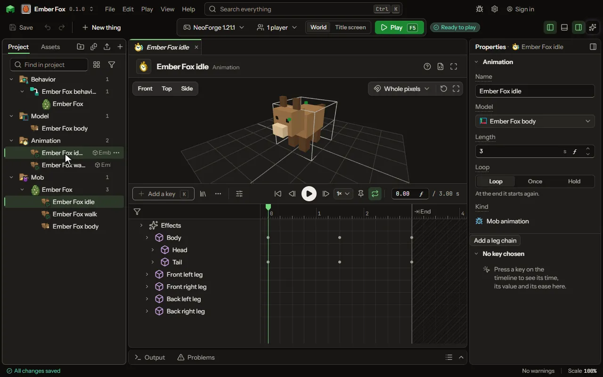

# Animation editor

How a model moves over time.

## How to add it

- New thing > Mobs and models > Animation
- New thing > Mobs and models > Player animation

## What you can set

| Setting | What it does |
| --- | --- |
| Name | A name for you, shown in the project and on a mob's Animations tab. Players never see it. |
| Model | The model whose parts this animation moves. It has to be one made for a mob, because the animation is kept by that model's parts. |
| Keys | How each part turns, moves and grows over time. Edited on the Animate tab. |

## What it becomes in the game

It is written into the mod when you Cook or press Play.

## What it works with

It points at: [Model](editor-model.md).

These point at it: [Projectile](editor-projectile.md), [Thing](editor-thing.md), [Vehicle](editor-vehicle.md).

## Picture

## Related pages

- [Animation](thing-animation.md)
- [Player animation](thing-playerAnimation.md)
- [Glossary](glossary.md)
