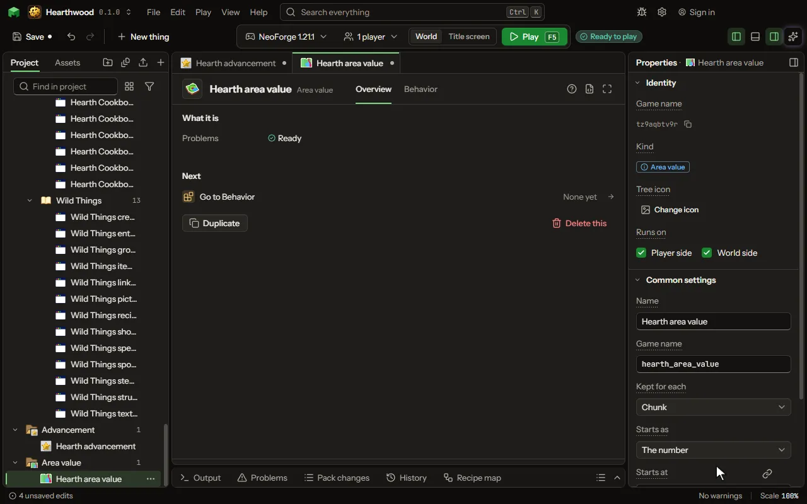

# Area value editor

A number the world keeps by place, not by player or item: an aura in each chunk, an oil reservoir under it, radiation, a corruption that spreads, a pollution. Where it is kept, how it starts, spreads and comes back, and what happens as it rises or falls are its own; rules read, add, take and set it at any place.

## How to add it

- New thing > Blocks and items > Area value

## What you can set

| Setting | What it does |
| --- | --- |
| Name | What the value is called in the game, such as Aura or Oil. |
| Game name | The value's id in the game; the world saves it by this, and rules of another mod read it by it. |
| Kept by another mod | Another mod's area value this one stands for, such as its aura. Your rules read and change that mod's amount, hear when it rises or falls, and your HUD shows it. |
| Kept for each | The area that holds one number: each chunk (16 by 16 blocks, all the way down), each square of chunks, each biome, or each dimension. Choose one of: Chunk, Square of chunks, Biome, Dimension, Block, Sealed room. |
| Square size | How many chunks across one square is. From 2 to 64 chunks. |
| Starts as | What a place has the first time it is asked of: the number below, a random number between the two (the same in the same world), or a smooth noise between them so nearby places are alike. Choose one of: The number, Random in a range, Smooth noise. |
| Starts at | What a place starts with, or the low end of its range. A formula of the place may stand in, such as its height. From -1000000000 to 1000000000. |
| Up to | The high end of the range a place starts in. From -1000000000 to 1000000000. |
| Noise size | How many areas across one hill of the noise is: more makes wider patches. From 1 to 256. |
| Chance of any | How many places in a hundred start with any at all; the rest start at the least, as most chunks hold no oil. From 0 to 100 percent. |
| Starts elsewhere | Other numbers where a place is in a biome, a group of biomes (#) or a dimension, the first that holds: more oil under deserts, no aura in the Nether. Each row has: Where, From, To. |
| Least | It never goes below this. From -1000000000 to 1000000000. |
| Most | It never goes above this; a HUD bar is full at it. From -1000000000 to 1000000000. |
| Comes back | How much it moves back by itself each second, as an aura recovers or radiation fades. Nought leaves it to the rules. A place far from everyone is caught up when next asked. From 0 to 1000000000 perSecond. |
| Comes back by | So much a second, or so many in a hundred of the way left a second (fast at first, slow near the end). Choose one of: An amount, A share of the way. |
| Comes back to | Where it settles: where the place started, its least, or its most. Choose one of: Where it started, Its least, Its most. |
| Spreads | How much of the difference with each area beside it moves across each second, in a hundred. Nought keeps each area to itself. From 0 to 100 percent. |
| Spreads how | Evens out, more flowing to less as an aura does; or grows outward from the areas at or above a level without them losing any, as a corruption does. Choose one of: Evens out, Grows outward. |
| Grows from | Only areas at or above this number grow into the areas beside them. From -1000000000 to 1000000000. |
| Swings through the day | How far the number rises at noon and falls at midnight, as a temperature does. Nought leaves the day out of it. A place reads its kept number plus this swing plus the blocks that push it. From -1000000000 to 1000000000. |
| Swings through the year | How far the number rises, then falls, once in a year of the days below. Nought leaves the seasons out. From -1000000000 to 1000000000. |
| A year is | How many game days one swing through the year takes. From 2 to 1000 days. |
| Blocks that push it | A block that raises or lowers the number round it, within a radius: a heater, a climatiser, a vent. Every such block near a place counts. The number is read at the place, not kept. Each row has: Block, Pushes by, Within, Reaches. |
| Blocks it turns | Where the number is high enough, blocks of a kind turn into another kind: grass into a dead grass, stone into a rot. A turn can need a block of another kind beside it, which makes it spread block to block. Each row has: Block that turns, Becomes, Only beside, Chance each try, Where it is at least, Each turn adds. |
| Blocks that hold it back | Where one of these blocks stands within its reach, nothing turns: a ward, a purifier. Each row has: Block, Holds within. |
| Tries a second | How many random places round each player the game tries to turn each second. More tries spread faster and cost more. From 1 to 2000 perSecond. |
| Tries out to | How many blocks from each player the tries reach. From 4 to 64 blocks. |
| Vent blocks | A closed space with one of these blocks touching it keeps a number of its own, found by a fill from the place: air, pressure, heat. Open to the outside, too big, or with no vent, a place reads the outside number (the dimension's). Each row has: Block, Gives a second. |
| A new room starts at | What a room holds the first time it is sealed. Outside, the number starts as the settings above say, so an airless world can start at nought. From -1000000000 to 1000000000. |
| Biggest room | How many blocks of open space count as one room. A bigger space, or one with a hole to the outside, is not sealed. From 8 to 4000 blocks. |
| A step every | How often the blocks that hold it make, burn, cool, lose and pass it on: 20 ticks is a second. From 1 to 1200 ticks. |
| Found within | How far around each player blocks that hold it are found by themselves; blocks touching ones already found are found too, at any distance. From 0 to 32 blocks. |
| Blocks that hold it | Each kind of block that holds the number, such as a reactor's fuel cells, its casing and a heat sink, and how each passes it on, makes it, loses it and what happens at its limit. Each row has: Block, Passes on, Makes, Loses, Limit, At the limit, Turns into, Blast power, Lights at, Fuel let in, Lights when it holds, Uses up, Fuel let in by. |
| Makes more beside | A block makes more for each touching block of a kind, as a fuel cell beside a moderator does. Each touching block counts once. Each row has: Block, For each touching, More each step. |
| Burns fuel | A block makes it only while it burns fuel from its own slots or tank, as a reactor cell burns fuel rods or a burner burns oil. Each row has: Block, Fuel, Burns each step, Gives, Leaves, How many left. |
| Cooled by | A block that turns a fluid in its tank into another by the number it holds, as water boils into steam: the number falls, the hot fluid goes into a touching block that takes it. Each row has: Block, Takes fluid, Makes fluid, Most each step, Takes each mB. |
| Made from a fluid | A block makes it by turning a fluid in its tank into another, as a turbine turns steam or a hot loop gives its heat. The new fluid goes into a touching block that takes it. Each row has: Block, Uses fluid, Makes fluid, Most each step, Gives each mB. |
| Made from another value | A block makes it each step from another value it holds, as neutron flux makes heat in a reactor's cells. Each row has: Block, Other value, Times. |
| Turns into energy | A block turns what it holds above its start into energy in its own store, as a generator turns rotation into power. Each row has: Block, Most each step, Energy each. |
| Only in a formed build | Blocks hold it only while they are part of a formed build, and each formed build counts as one, so a reactor works only once it is complete. |
| Redstone stops it | While a block of a build gets a redstone signal, the blocks joined to it make and burn nothing, as a reactor's shutdown lever does. Coolant and losing go on. |
| Starts again below | A build stopped by a limit starts again once its highest block falls below this. Nought or less keeps it stopped until it is rebuilt. From -1000000000 to 1000000000. |
| Kept going within | How many chunks around each player spread and run the value's every-second moment; places further out wait until they are asked. From 0 to 16 chunks. |
| Shown to players | Each player's game is told the value where the player stands, so a HUD element can draw it. |

## What it becomes in the game

It runs on the player's side of the game.

## What it works with

It does not point at other things.

These point at it: [World event](editor-worldEvent.md), [Recipe](editor-recipe.md), [Behavior](editor-behaviour.md), [Machine recipe](editor-machineRecipe.md), [Station recipe](editor-stationRecipe.md), [Ritual](editor-ritual.md), [HUD number bar](editor-hud.md), [Species](editor-species.md).

## Picture

## Related pages

- [Area value](thing-areaValue.md)
- [Glossary](glossary.md)
