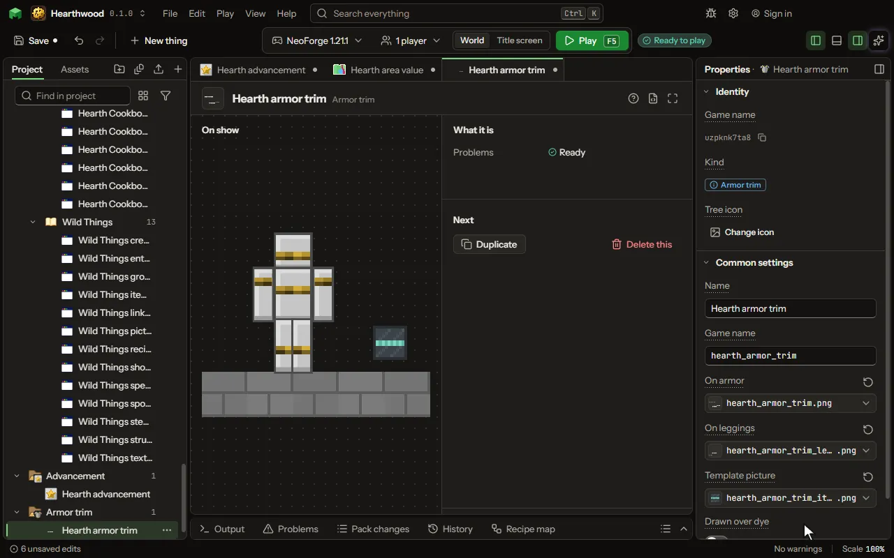

# Armor trim editor

A trim put on armor at the smithing table, in any of the game's materials.

## How to add it

- New thing > Crafting and loot > Armor trim

## What you can set

| Setting | What it does |
| --- | --- |
| Name | The trim's name; the game says it as the name and Armor Trim. |
| Game name | The trim's name in the game, as a command or a data pack names it. |
| On armor | The trim on a helmet, chestplate and boots, in the game's eight greys: each material colours them. |
| On leggings | The trim on leggings, in the same greys. |
| Template picture | The smithing template's picture, which puts the trim on armor. |
| Drawn over dye | Whether the trim is drawn as it is over dyed leather, as the game's own decal trims are. |

## What it becomes in the game

It is not part of the game itself: it describes another mod or a file, so it has no side to choose.

## What it works with

It does not point at other things.

## Picture

## Related pages

- [Armor trim](thing-armourTrim.md)
- [Glossary](glossary.md)
