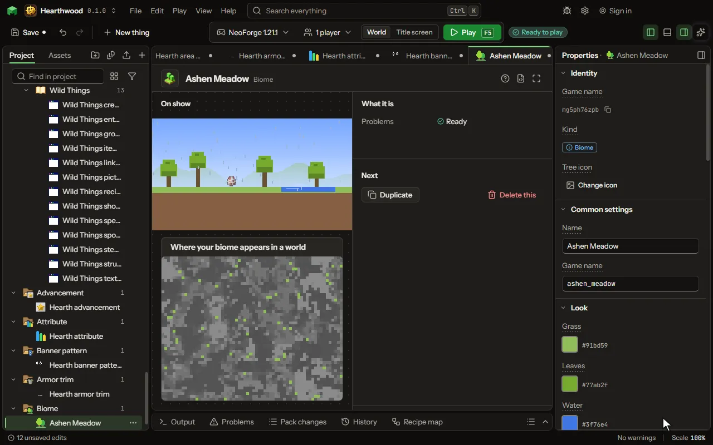

# Biome editor

A region of the world with its own look and life.

## How to add it

- New thing > The world > Biome

## What you can set

| Setting | What it does |
| --- | --- |
| Name | Its name, which the game shows where it names the biome a player stands in. |
| Game name | The biome's name in the game, as a command finds it: /locate biome. |
| Grass | The colour of its grass. |
| Leaves | The colour of the leaves of its trees and vines. |
| Water | The colour of its water. |
| Sky | The colour of its sky by day. |
| Fog | The colour of the haze in the distance. |
| Under water | The colour of the haze a swimmer sees under its water. |
| In the air | Specks that drift in its air, as the ash of the nether. |
| How many | How thick the specks are. From 0 to 100 percent. |
| Music | What plays while a player is there. Left empty, the game's own music plays. |
| Always heard | A sound that plays over and over while a player is there, as the nether's hum. |
| Now and then | A sound heard now and then, as the nether's distant groans. |
| Mobs | What lives there. Each is as likely as its weight beside the others of its group. Each row has: Mob, Group, Weight, At least, At most. |
| Ores and caves | The game's own ores, geodes, dungeons, springs and lava lakes, as under its plains. |
| Grass and flowers | The game's own grass, flowers, oaks, mushrooms, pumpkins and sugar cane, as on its plains. |
| Caves in it | Your own caves, or the game's, that are cut into this biome, besides the usual ones. |
| Caves and ravines | Whether caves and ravines are cut into its ground. |
| Ground on top | The block on top of its ground in a dimension of yours with hills or shaped land. In the overworld, lay blocks with Its ground. |
| Ground below | The blocks just under the top in a dimension of yours with hills. |
| Its ground | Blocks laid in its ground by where they are: on top, under the top, on steep slopes, under water, on cave ceilings, below or above a height. The first row that fits a block wins; the top and under blocks lie beneath them all. Each row has: Block, Where, Depth, Height, Patches. |
| Appears | Where the world makes it. A dimension of yours lists its own biomes too. Choose one of: In the overworld, In the nether, Only in a dimension of yours. |
| Placed | Beside one of the game's biomes, in a share of its places; or by its land, in a share of every place of the warmth, wetness and land you choose, so it stands on land of that height and roughness. Choose one of: Beside one of the game's, By its land. |
| In place of | One of the game's biomes: yours appears where it would, in a share of its places. |
| Land | The shape of the land it takes. Its height and roughness come from there: lowlands are flat, mountains steep, valleys low beside rivers, caves under the ground. Choose one of: Any land, Ocean, Coast, Lowlands, Hills, Mountains, Peaks, Valleys, Caves underground. |
| Warmth | How warm the places it takes are, in the game's five bands. Choose one of: Any, Frozen, Cold, Mild, Warm, Hot. |
| Wetness | How wet the places it takes are, from desert dry to jungle wet. Choose one of: Any, Arid, Dry, Middling, Wet, Very wet. |
| Share | How much of that biome's land becomes yours. From 1 to 100 percent. |
| Land height | How far above or below its dimension's land height its ground stands, in a dimension with a shaped land. From -48 to 96 blocks. |
| Roughness | How rough its ground is: nought is flat, a hundred is steep hills and cliffs. Its dimension's hilliness scales it. From 0 to 100 percent. |
| Weather | What falls from its sky. Choose one of: Rain, Snow, Nothing, dry as a desert. |

## What it becomes in the game

It is not part of the game itself: it describes another mod or a file, so it has no side to choose.

## What it works with

It points at: [Particle](editor-particle.md), [Sound](editor-sound.md), [Mob](editor-creature.md), [Caves](editor-carver.md), [Block](editor-block.md).

These point at it: [Feature](editor-feature.md), [Structure](editor-structure.md), [Dimension](editor-dimension.md).

## Picture

## Related pages

- [Biome](thing-biome.md)
- [Glossary](glossary.md)
