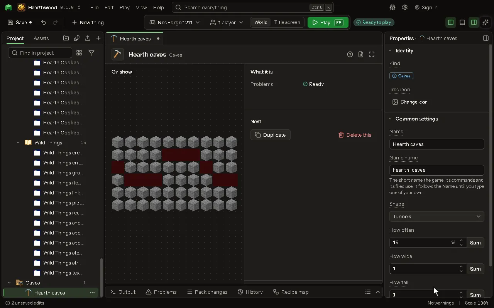

# Caves editor

Caves, ravines or Nether tunnels the world cuts into its ground. Give them to your biomes.

## How to add it

- New thing > The world > Caves

## What you can set

| Setting | What it does |
| --- | --- |
| Name | What you call it here. The game never shows it. |
| Game name | The cave's name in the game, as a biome finds it. |
| Shape | Round tunnels, one long deep crack, or tunnels like the Nether's. Choose one of: Tunnels, A long crack, Nether tunnels. |
| How often | The chance, in each part of the world, that this cave starts there. From 0 to 100 percent. |
| How wide | How wide it is, as a multiple of the game's own. 1 is the usual width. From 0.2 to 5. |
| How tall | How tall it is, as a multiple of the game's own. 1 is the usual height. From 0.2 to 5. |
| From height | The lowest height it starts at. Sea level is 63. From -64 to 320 blocks. |
| To height | The highest height it starts at. From -64 to 320 blocks. |
| Lava below | Under this height the empty space is filled with lava instead of air. From -64 to 320 blocks. |
| Also cuts through | Blocks it can cut besides what the game's caves cut (stone, dirt, sand and the like). |

## What it becomes in the game

It is not part of the game itself: it describes another mod or a file, so it has no side to choose.

## What it works with

It points at: [Block](editor-block.md).

These point at it: [Biome](editor-biome.md).

## Picture

## Related pages

- [Caves](thing-carver.md)
- [Glossary](glossary.md)
