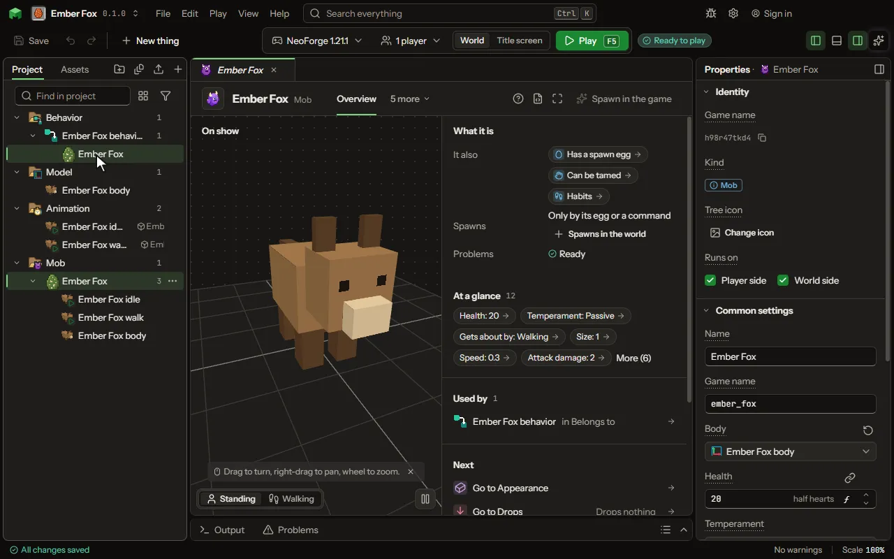

# Mob editor

A living thing with a model, animations and behavior.

## How to add it

- New thing > Mobs and models > Mob
- New thing > Mobs and models > Pet
- New thing > Mobs and models > Mount
- New thing > Mobs and models > Flying mount
- New thing > Mobs and models > Sea mount
- New thing > Mobs and models > Boss

## What you can set

| Setting | What it does |
| --- | --- |
| Name | What players read above it and on its spawn egg, in any words: spaces and capitals are fine, like "Ruby Blade of Sam". The Game name is the short name the game uses instead. |
| Game name | The short name the game and its commands use: small letters, digits and underscores, like katana. In commands and recipes the mod's short name and a colon go in front: for a mod called rubygear, katana is written rubygear, a colon, then katana. Players never read it; that is the Name. /summon uses it. Change it later and it is renamed everywhere. |
| Body | The model it wears: one made for a mob, with its feet on the ground and its front facing away from you. |
| Health | How much damage it takes to kill it. A player has 20, which is ten hearts. |
| Temperament | Passive runs when hurt. Neutral fights back when hurt. Hostile goes after the nearest player. Choose one of: Passive, Neutral, Hostile. |
| Gets about by | How it gets about: walking, climbing walls, flying, fluttering with no aim, swooping (circling and diving), swimming, swimming and leaping out, or set in a wall face. Choose one of: Walking, Climbing, Flying, Fluttering, Swooping, Swimming, Swimming and leaping, Set in a wall, Walking and flying. |
| Circles at | How high it circles over where it is, or over what it fights, before it dives. From 1 to 64 blocks. |
| Circle size | How wide the circle it flies round is, in blocks from its middle. From 1 to 64 blocks. |
| Leaps every | How often it jumps out of the water ahead of it, when swimming near the top. From 1 to 600 seconds. |
| Takes off above | It walks, and lifts off when what it hunts is this many blocks above it, or when it falls. A rule can also make it take off. From 0.5 to 64 blocks. |
| Lands within | It flies down and lands when what it hunts stands on the ground this close. From 1 to 64 blocks. |
| Lands after | How long it stays up with nothing to hunt before it comes down. 0 means it stays up until a rule lands it. From 0 to 600 seconds. |
| Sunk into the wall | How deep its back sits in the block of the nearest wall face it holds to. From 0 to 4 blocks. |
| Settles on | The blocks it now and then lands on and rests a while: flowers for a butterfly. Empty: it never settles. |
| Rests for | How long it sits on a block before it flutters off again. A player coming near startles it sooner. From 0 to 600 seconds. |
| Size | How big it is drawn and how big it stands, its hitbox with it: 1 is the size of its body, 0.5 half, 2 twice. From 0.0625 to 16. |
| Its own picture | A picture in place of the one its body wears, laid out the same way: a variant wears the same body in other colours. |
| Other looks | Other pictures it can wear, laid out as its own is. A rule puts one on (Make it wear the look ...), and it keeps it when the world is saved. Each row has: Called, Picture. |
| Its own numbers | Numbers each mob keeps, such as its anger. Rules set and read them like any value. Each row has: Name, Most. |
| Width | How wide it is to hit and to collide with, in blocks. |
| Height | How tall it is to hit and to collide with, in blocks. |
| Made from the game's | The game's own thing this one behaves like; its behaviour stays the game's. A creature from the game, such as a zombie or a cow, written with its game name. Empty: a creature of its own. |
| Counted as | Which of the game's own groups it belongs to, which decides how many of it the world keeps around and when they spawn. Choose one of: An animal, A monster, Ambient, like a bat, A water animal. |
| Speed | How fast it walks. A cow walks at 0.2 and a zombie at 0.23. |
| Attack damage | How much one of its hits hurts, before armour. |
| Armour | How much of each hit its armour takes away, as a player's armour bar counts it. |
| Armour toughness | How well its armour holds against strong hits. |
| Knockback resistance | How much of a hit's push it ignores: 0 is none of it, 1 is all of it. |
| Follow range | How far away, in blocks, it notices a target and keeps after it. |
| Flying speed | How fast it flies, for a mob that flies. |
| Attack knockback | How far its hits push what they land on. |
| Step height | How high a step it walks up without jumping, in blocks. |
| Sound it makes | A sound, the game's or your own, it makes now and then. Empty keeps the game's. |
| Sound when hurt | A sound, the game's or your own, it makes when it is hurt. Empty keeps the game's. |
| Sound when it dies | A sound, the game's or your own, it makes when it dies. Empty keeps the game's. |
| Boss bar | Shows its health as a bar across the top of the screen to every player near it, as the Wither does. |
| Takes no hurt from | The damage types it shrugs off, the game's own and your own: a blaze takes no fire, a snow golem no freezing. |
| Tips over when it dies | Whether it falls on its side when it dies, as the game's own animals do. Off, it stays standing while it fades. |
| What it is doing | Which animation it plays for what it is doing. Edited on the Animations tab. |
| Order of its behaviours | Which of its behaviours comes first. Set by dragging them on the Mind tab, or with Move up and Move down. |
| Thinks every tick | A piece of your own code that the game runs twenty times a second for every one of these mobs, after its own goals, for what the settings here cannot say: a flight that circles and dives, a head that watches its own target. |
| Poses every frame | A piece of your own code that turns, moves, grows or hides its parts every frame it is drawn, after its animations: a body per stage of growth, segments that follow the head. |

## What it becomes in the game

It is added to the game, so a player needs your mod to see it.

## What it works with

It points at: [Model](editor-model.md), [Sound](editor-sound.md), [Damage type](editor-damageType.md), [Code](editor-code.md).

These point at it: [World event](editor-worldEvent.md), [Drop](editor-drop.md), [Behavior](editor-behaviour.md), [Biome](editor-biome.md), [Structure](editor-structure.md), [Game thing changed](editor-gameChange.md), [Species](editor-species.md), [Worn slots](editor-wornSlots.md).

## Picture

## Related pages

- [Mob](thing-creature.md)
- [Pet](thing-pet.md)
- [Mount](thing-mount.md)
- [Flying mount](thing-flyingMount.md)
- [Sea mount](thing-seaMount.md)
- [Boss](thing-boss.md)
- [Glossary](glossary.md)
