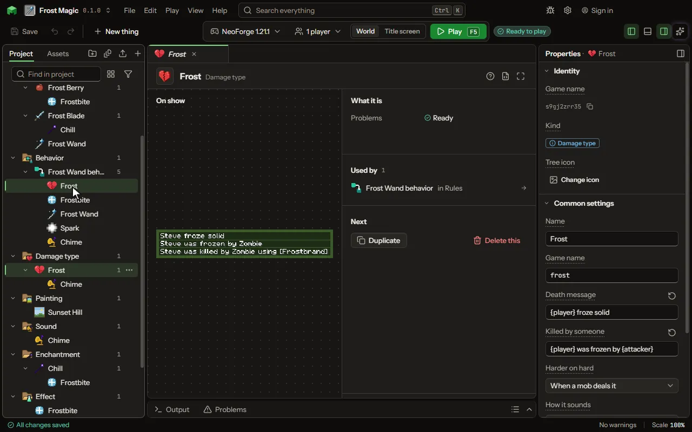

# Damage type editor

A way of getting hurt, with its own message.

## How to add it

- New thing > Logic and code > Damage type

## What you can set

| Setting | What it does |
| --- | --- |
| Name | A name for you. Players read the death messages, not this. |
| Game name | The damage type's name in the game, as a command, a data pack or another mod names it. |
| Death message | What the chat says when it kills a player on its own. (player) is the player's name. |
| Killed by someone | What the chat says when someone dealt it. (attacker) is who dealt it. |
| Killed with an item | What the chat says when the one who dealt it held an item with a name of its own. (item) is that name. |
| Harder on hard | Whether it hurts more on Hard and less on Easy, as a zombie's bite does. Choose one of: Never, When a mob deals it, Always. |
| Hunger it costs | How much hunger a hit takes from a player, as swimming or sprinting does. Most hits take 0.1. From 0 to 10. |
| How it sounds | The game's own hurt sound the victim makes: an ordinary hurt, thorns, drowning, burning, a sweet berry's poke or freezing. Choose one of: Hurt, Thorns, Drowning, Burning, Poking, Freezing. |
| Also plays | Any sound, one of the game's or of your own, played where it lands when a rule deals it. |
| Goes through armour | Armour does not soften it, as starving and falling into the void are not. |
| Goes past a shield | A raised shield does not stop it. |
| Goes past Protection | Protection and the other enchantments that soften a hit do not soften this one. |
| Goes past Resistance | The Resistance effect does not soften it. |
| Is fire | Fire Resistance stops it and Fire Protection softens it, and a thing immune to fire is immune to it. |
| Is a projectile | Projectile Protection softens it, as it softens an arrow. |
| Is an explosion | Blast Protection softens it, as it softens a creeper. |
| Is freezing | What cannot freeze, a snow golem or a stray, takes none of it. |
| Is lightning | It turns a pig to a zombified piglin and a villager to a witch, as lightning does. |
| Is drowning | What breathes water takes none of it. |
| Is a fall | Feather Falling softens it, and what never takes a fall takes none of it. |
| No knockback | The victim is not pushed back when it lands. |
| Angers no one | A mob hurt by it does not turn on whoever dealt it. |

## What it becomes in the game

It is not part of the game itself: it describes another mod or a file, so it has no side to choose.

## What it works with

It points at: [Sound](editor-sound.md).

These point at it: [Mob](editor-creature.md).

## Picture

## Related pages

- [Damage type](thing-damageType.md)
- [Glossary](glossary.md)
