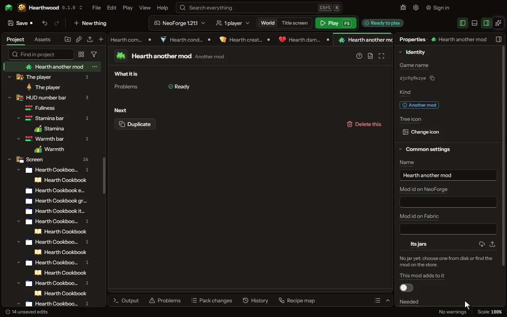

# Another mod editor

A mod this one uses or works with, such as a recipe viewer: compiled against, in the test game, and named in both manifests.

## How to add it

- New thing > Logic and code > Another mod

## What you can set

| Setting | What it does |
| --- | --- |
| Name | The mod's name, as players know it. |
| Store name | The name this mod has on the store, kept when you add it from there so it can be fetched again for other versions. |
| Mod id on NeoForge | Its id on NeoForge, written into this mod's manifest. Leave it empty when it is not on NeoForge. |
| Mod id on Fabric | Its id on Fabric, written into this mod's manifest. Leave it empty when it is not on Fabric. |
| Its NeoForge jar | The other mod's jar for NeoForge, picked from disk. Its things join every picker; your code compiles against it. |
| Its Fabric jar | The other mod's jar for Fabric, picked from disk. Its things join every picker; your code compiles against it. |
| Its jars | The other mod's jars, one for NeoForge and one for Fabric on each game version this mod is made for, picked from disk or fetched from the mod store. Its things join every picker; your code compiles against them; the test game runs with them. Each row has: Jar, Made for, Game version, Is. |
| This mod adds to it | This mod is an add-on of it. Its area values, kinds of energy, genes, species and studies show in your lists by their names, and your species join its genes. |
| Needed | Required: a player must install it. Optional: this mod works with it when it is there. Choose one of: Required, Optional. |
| From version | The lowest version of it this mod works with. |
| NeoForge jar is for | The game version its NeoForge jar is made for, read from the jar. Only that version compiles against it. |
| Fabric jar is for | The game version its Fabric jar is made for, read from the jar. Only that version compiles against it. |
| Published at | The Maven repository it is published in, when it is not Maven Central or one NeoForge and Fabric already know. |
| Compiled against | Coordinates both targets compile against, such as its common API; several separated by spaces. Each is group:name:version, as the mod's page for developers lists it, such as com.example:examplemod-common-api:1.0.0. |
| NeoForge: compiled against | Coordinates NeoForge alone compiles against; several separated by spaces. Each is group:name:version, as the mod's page for developers lists it, such as com.example:examplemod-common-api:1.0.0. |
| NeoForge: in the test game | Coordinates of the mod itself, loaded in NeoForge's test game. |
| Fabric: compiled against | Coordinates Fabric alone compiles against; several separated by spaces. Each is group:name:version, as the mod's page for developers lists it, such as com.example:examplemod-common-api:1.0.0. |
| Fabric: in the test game | Coordinates of the mod itself, loaded in Fabric's test game. |
| Carried inside | This mod's jar carries it, so a player installs nothing more: for a library, never for a mod players install on their own. |
| Finds your classes as | On Fabric, the entry points it looks up, each name=class, such as examplemod_plugin=mod.mymod.MyPlugin. NeoForge finds a plugin by its annotation. |

## What it becomes in the game

It is not part of the game itself: it describes another mod or a file, so it has no side to choose.

## What it works with

It does not point at other things.

## Picture

## Related pages

- [Another mod](thing-dependency.md)
- [Glossary](glossary.md)
