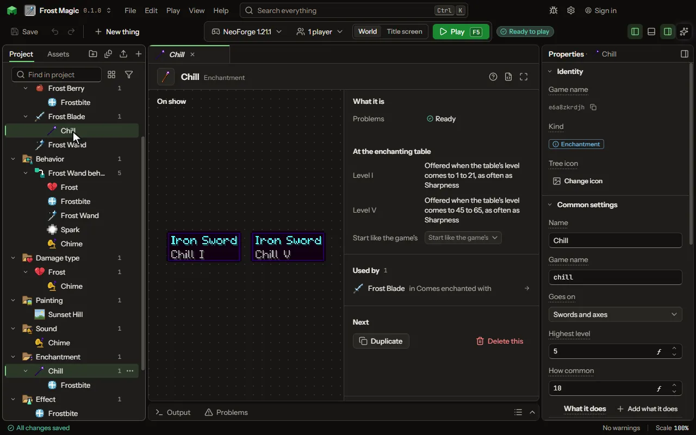

# Enchantment editor

A power added to a tool or weapon.

## How to add it

- New thing > Crafting and loot > Enchantment

## What you can set

| Setting | What it does |
| --- | --- |
| Name | The enchantment's name, as its tooltip line shows it. |
| Game name | The enchantment's name in the game, as /enchant and a data pack name it. |
| Goes on | What an anvil puts it on: the game's own groups of tools, weapons and armour, which a mod's own join when they are of the same sort. Choose one of: Swords, Swords and axes, Weapons, Mining tools, Mining tools, for loot, Armour, Helmets, Chestplates, Leggings, Boots, Bows, Crossbows, Tridents, Maces, Fishing rods, Anything that wears out, Anything worn, Anything at all. |
| Offered on | What the enchanting table offers it for; an anvil still puts it on everything it goes on. Choose one of: What it goes on, Swords, Swords and axes, Weapons, Mining tools, Mining tools, for loot, Armour, Helmets, Chestplates, Leggings, Boots, Bows, Crossbows, Tridents, Maces, Fishing rods, Anything that wears out, Anything worn, Anything at all. |
| Highest level | The strongest it comes: Sharpness goes to V, Knockback to II. From 1 to 255. |
| How common | How often the table and loot pick it against the others: Sharpness and Protection are 10, Fire Aspect 2, Mending and Thorns 1. From 1 to 1024. |
| What it does | Each a thing the game does for it with no code, stronger each level. Each row has: Does, At level I, Each level more, Changes, Effect, For. |
| Works when | Where the enchanted thing must be for it to work. Choose one of: Held in the main hand, Held in the off hand, Held in either hand, Worn on the head, Worn on the chest, Worn on the legs, Worn on the feet, Worn anywhere, Anywhere. |
| Not with | The game's own set it cannot share a thing with, as Sharpness cannot share one with Smite. Choose one of: Goes with any, Sharpness, Smite, Bane, The Protections, Frost Walker, Depth Strider, Infinity, Mending, Multishot, Piercing, Fortune, Silk Touch, Riptide's others. |
| From | The enchanting table's levels it is offered at: from the first number, a second number more each level, over a span of the third. From 0 to 255. |
| Each level | The enchanting table's levels it is offered at: from the first number, a second number more each level, over a span of the third. From 0 to 255. |
| Span | The enchanting table's levels it is offered at: from the first number, a second number more each level, over a span of the third. From 0 to 255. |
| Anvil cost | Levels an anvil asks to put it on from a book, each level of it: Sharpness 1, Fire Aspect 4. From 0 to 255. |
| At the table | The enchanting table can offer it. |
| Sold by librarians | A librarian may sell a book of it. |
| In loot | Chests and fishing may give it on an enchanted thing. |
| On mobs' gear | A mob's own gear, and what villagers sell, may come with it. |
| Treasure | Rare, as Mending is: never at the table, and a librarian asks twice as much for it. |
| Curse | A curse, as Binding is: its line is red and a grindstone cannot take it away. |

## What it becomes in the game

It is not part of the game itself: it describes another mod or a file, so it has no side to choose.

## What it works with

It points at: [Effect](editor-effect.md).

## Picture

## Related pages

- [Enchantment](thing-enchantment.md)
- [Glossary](glossary.md)
