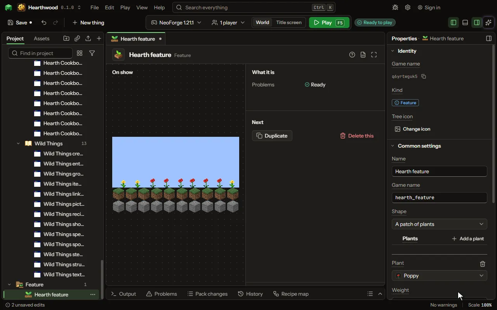

# Feature editor

Something the world grows as it is made: a patch of flowers, a tree, a boulder, a lake, a vein of a block.

## How to add it

- New thing > The world > Feature

## What you can set

| Setting | What it does |
| --- | --- |
| Name | What you call it here. The game never shows it. |
| Game name | The feature's name in the game, as a command places it: /place feature. |
| Shape | What the world makes each time it places one. Choose one of: A patch of plants, A tree, A boulder, A lake, A vein under the ground, A round patch in the ground, A spring in a cave wall, A geode, A huge mushroom, A pile, A column, An iceberg, Basalt columns, A patch of ground, A fossil, A dripstone cluster, A desert well, A delta, Blobs in the ground, Kelp, Seagrass, Sea pickles, Bamboo, A mix of your features, A growth on cave walls, Nether plants, Nether vines, A huge fungus, A sculk patch, Magma under the sea, A dungeon, Vines, Glowstone, A basalt pillar, Blue ice, Coral, A chorus plant, An island in the End, One block, A replaced block, A filled layer, Frozen water and snow, An ice spike, An End spike, An End gateway, A great dripstone, A pointed dripstone, A tree with roots, Scattered ore, A ground patch under water, One of two features, A bonus chest, A patch of flowers (the game's flower type), A patch of bushes or plants (the game's random patch), One of several features, evenly, The End's obsidian platform, A starting platform in the void, Deposits from a list. |
| Plants | What the patch is made of. Each is as likely as its weight: two poppies for every dandelion. Each row has: Plant, Weight. |
| Plants a patch | How many times it tries to plant one in a patch. Some land where nothing grows. From 1 to 128. |
| Spread | How far from the middle of the patch a plant may land. From 1 to 16 blocks. |
| Trunk | The block the trunk is made of: a log of the game's or a block of yours. |
| Leaves | The block the leaves are made of. |
| Tree shape | How its leaves sit on the trunk, as the game's own trees. Choose one of: Round, as an oak, Pointed, as a spruce, Tall with branches, as a big oak, A low bush. |
| Trunk height | How tall the trunk grows, before a few blocks more by chance. From 1 to 32 blocks. |
| Made of | The block it is made of. |
| Found in | The ground the vein replaces. Choose one of: Stone, Deepslate, Netherrack, End stone. |
| Vein size | About how many blocks a vein holds. From 1 to 64. |
| Lowest | The lowest and highest height a vein is placed at. The world's bottom is minus sixty four. From -64 to 320. |
| Highest | The lowest and highest height a vein is placed at. The world's bottom is minus sixty four. From -64 to 320. |
| How many per chunk | How many veins it tries to place in each chunk. From 1 to 64. |
| Filled with | What the lake holds, or what the spring pours. Choose one of: Water, Lava. |
| Rim | The block around the lake where it meets the ground. |
| Across | How far the patch reaches from its middle. From 1 to 8 blocks. |
| Outer shell | The block of its outside, as the game's smooth basalt. |
| Middle shell | The block between, as the game's calcite. |
| Inside | The block that lines its hollow, as the game's amethyst. |
| Crystals | What grows on the inside. Left empty, nothing does. |
| Scattered | Whether its ores lie apart, one here and one there, as ancient debris does. |
| Only buried | Whether ores that would touch air are left out, as diamonds are. |
| Cap shape | The red mushroom's dome or the brown one's flat cap. Choose one of: Dome, Flat. |
| Cap | The block its cap is made of. |
| Stem | The block its stem is made of. |
| Cap width | How far the cap reaches from the stem. From 1 to 6 blocks. |
| Made of | The block the pile is made of, as hay bales in a village. |
| Made of | The block stacked up into a column, as sugar cane grows. |
| Up to | How tall it is, at most. From 1 to 32 blocks. |
| Made of | The block the iceberg is made of. It floats at the sea's level in an ocean. |
| Spread | How far its columns spread, as the Nether's basalt deltas. From 0 to 3 blocks. |
| Up to | How tall its columns of basalt rise at most. From 1 to 10 blocks. |
| Ground | The block laid over the ground, as moss in a lush cave. |
| Grows on it | The plant on most of the ground. Left empty, the ground is bare. |
| Across | How far the ground reaches from its middle. From 1 to 12 blocks. |
| Tree | One of your tree features. The roots grow round it and under it. |
| Roots | The block the roots are made of, as rooted dirt under an azalea. |
| Either | One of your features. It is placed half the time. |
| Or | Another of your features, placed the other half. A feature here grows only through this one, not on its own. |
| Bones | Which of the game's own fossils it leaves underground. Choose one of: Spines, Skulls, Spines and skulls. |
| Across | How far its stalactites and stalagmites reach in a cave. From 2 to 8 blocks. |
| Rim | The block around each pool, as magma round the Nether's lava deltas. |
| Across | How far its pools spread at most. From 1 to 16 blocks. |
| In | The block the blobs replace where they find it. |
| Made of | The block each blob is made of, as blackstone in netherrack. |
| Across | How far a blob reaches from its middle. From 1 to 12 blocks. |
| Tall | How much of it grows two blocks tall. From 0 to 100 percent. |
| How many | How many sea pickles it tries to place. From 1 to 64. |
| On podzol | How often the ground under it turns to podzol, as in a bamboo jungle. From 0 to 100 percent. |
| Picks one of | Your other features, one of them at each place, each as likely as its weight, as a forest mixes its trees. A feature here grows only through the mix, not on its own. Each row has: Feature, Weight. |
| Growth | What grows over the stone of caves. Choose one of: Glow lichen, on walls and ceilings, Sculk veins, on every side. |
| Reach | How far from where it starts it looks for stone to cover. From 1 to 64 blocks. |
| Plants | What spreads over the ground, each as likely as its weight. It grows only on nylium, as in a crimson forest. Each row has: Plant, Weight. |
| Grows | Which way the vines grow, as the Nether's own. Choose one of: Up from the ground, twisting, Down from the ceiling, weeping. |
| Grows on | The ground it grows from, as crimson nylium. |
| Stem | The block its stem is made of, as a crimson stem. |
| Cap | The block its cap is made of, as nether wart. |
| Lights | The block dotted through its cap, as shroomlight. Left empty, the cap is whole. |
| Spread | How far the sculk spreads from its middle. From 1 to 32. |
| With a catalyst | How often a sculk catalyst stands in the middle of it. From 0 to 100 percent. |
| Coral shape | Which of the warm ocean's corals grows, of the game's coral colours. Choose one of: A tree of branches, A claw, A mushroom. |
| List | The list of entries the player edits that says each deposit: its block, size, how rare and how deep. |
| Block field | The list's field that holds each deposit's block. |
| Size field | The list's field that holds each deposit's size, in blocks. |
| Rarity field | The list's field that holds how rare each deposit is: one chunk in this many. Missing, it is every chunk. |
| Lowest field | The list's field that holds the lowest height a deposit lies at. |
| Highest field | The list's field that holds the highest height a deposit lies at. |
| How often | How many the world places in each chunk, a square of sixteen blocks. Choose one of: Everywhere, eight a chunk, Often, three a chunk, Sometimes, one a chunk, Rarely, one in eight chunks, Very rarely, one in thirty two chunks, In clumps, thick in some places and thin in others, Just so many. |
| In each chunk | How many it places in a chunk where it places any. From 1 to 256. |
| Once in | It places any in one chunk of this many; one is every chunk. From 1 to 1000 chunks. |
| Where | At what height it is placed. Choose one of: Where it belongs: on the ground, or under it, On the ground, Between two heights, Most in the middle of two heights, On the top of the world, water too, On the ground, under the sea too, On cave floors, On cave ceilings. |
| Lowest | The lowest height it is placed at. The world's bottom is minus sixty four. From -64 to 320. |
| Highest | The highest height it is placed at. The sea is at sixty three. From -64 to 320. |
| Only on these blocks | It is placed only on top of one of these blocks. Empty means any block. |
| Only in | Keep it to places full of water, or to open air. Choose one of: Anywhere, Only in water, Only in air. |
| Not near the surface | It stays at least this many blocks below the ground. Zero means no limit. From 0 to 128 blocks. |
| Only in its biomes | On, as the game does: it is placed only in the biomes above. Off lets other things that place it decide. |
| In biomes | Where it grows: the game's biomes, a group of them such as every overworld biome, or biomes of yours. |

## What it becomes in the game

It is not part of the game itself: it describes another mod or a file, so it has no side to choose.

## What it works with

It points at: [Block](editor-block.md), [Mod settings](editor-configValue.md), [Biome](editor-biome.md).

## Picture

## Related pages

- [Feature](thing-feature.md)
- [Glossary](glossary.md)
