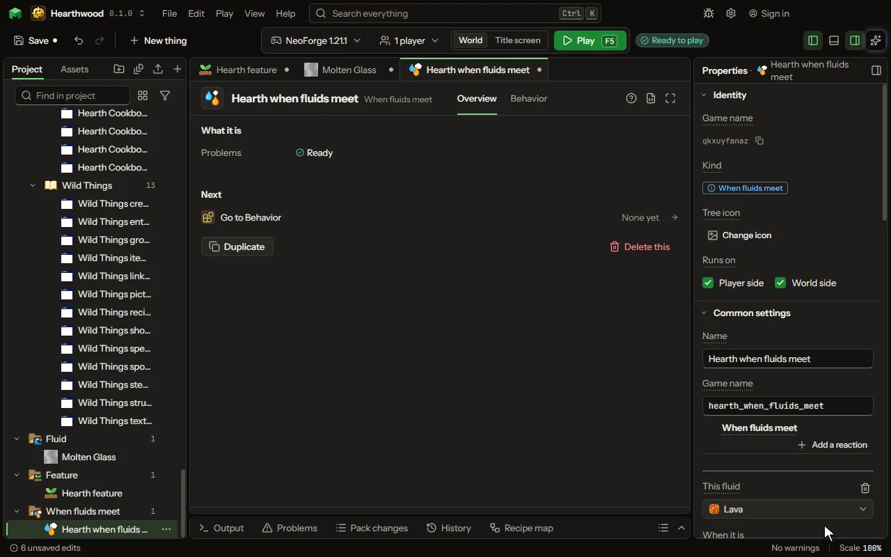

# When fluids meet editor

What happens where a fluid meets another fluid or a block: lava meeting water makes obsidian, your own fluid meeting lava makes a block or drops an item. Each row says which fluids, what it makes, where, how often, and the sound and particles. It starts with the game's own two rows, which you can change or take away.

## How to add it

- New thing > Machines and networks > When fluids meet

## What you can set

| Setting | What it does |
| --- | --- |
| Name | What this table is called in your project. |
| Game name | The name the table is written under in the game's files, in small letters with underscores. |
| When fluids meet | One row for each meeting. A row is checked wherever the first fluid has the other fluid or block touching it, as the fluid is placed and whenever a block beside it changes. Each row has: This fluid, When it is, Meets the fluid, Or meets the block, Makes, As a, Where, How often, Sound, Particles, On the side. |

## What it becomes in the game

It is written into the mod when you [Cook](glossary.md#cook) or press [Play](glossary.md#play).

## What it works with

It points at: [Fluid](editor-fluid.md).

These point at it: [Behavior](editor-behaviour.md).

## Picture

## Related pages

- [When fluids meet](thing-fluidReactions.md)
- [Glossary](glossary.md)
