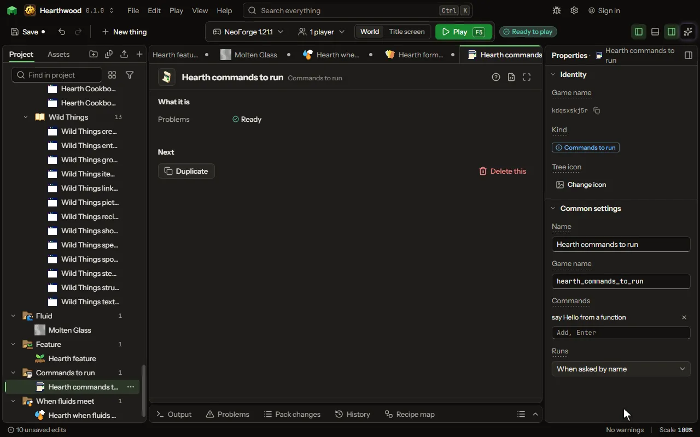

# Commands to run editor

A list of the game's commands run together by name, when a world loads, or every tick.

## How to add it

- New thing > Logic and code > Commands to run

## What you can set

| Setting | What it does |
| --- | --- |
| Name | What it is called here. |
| Game name | Its name inside the game, run as /function yourmod:name. |
| Commands | One command a line, as typed in the chat but without the slash, run in order. |
| Runs | Only when asked by name (a command, a rule, another function), each time a world loads, or every tick, twenty times a second. Choose one of: When asked by name, When a world loads, Every tick. |

## What it becomes in the game

It is not part of the game itself: it describes another mod or a file, so it has no side to choose.

## What it works with

It does not point at other things.

## Picture

## Related pages

- [Commands to run](thing-function.md)
- [Glossary](glossary.md)
