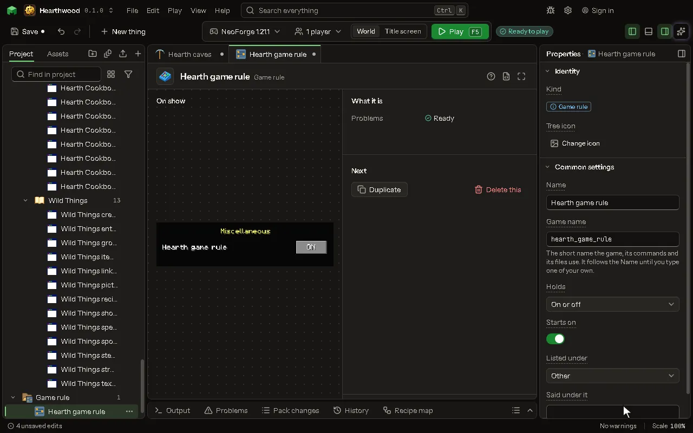

# Game rule editor

A rule of the world, set with the gamerule command.

## How to add it

- New thing > Logic and code > Game rule

## What you can set

| Setting | What it does |
| --- | --- |
| Name | The rule's name, as the Edit Game Rules screen lists it. |
| Game name | The rule's name in the game, as the gamerule command and a rule's words name it after the mod's name. |
| Holds | Whether the rule is on or off, as keep inventory is, or a number, as the random tick speed is. Choose one of: On or off, A number. |
| Starts on | Whether the rule is on in a new world until someone sets it. |
| Starts at | The rule's number in a new world until someone sets it. From -1000000 to 1000000. |
| Listed under | Where the Edit Game Rules screen lists it. Choose one of: Player, Mobs, Spawning, Drops, World updates, Chat, Other. |
| Said under it | A line the Edit Game Rules screen shows when the pointer rests on the rule. |

## What it becomes in the game

It is not part of the game itself: it describes another mod or a file, so it has no side to choose.

## What it works with

It does not point at other things.

## Picture

## Related pages

- [Game rule](thing-gameRule.md)
- [Glossary](glossary.md)
