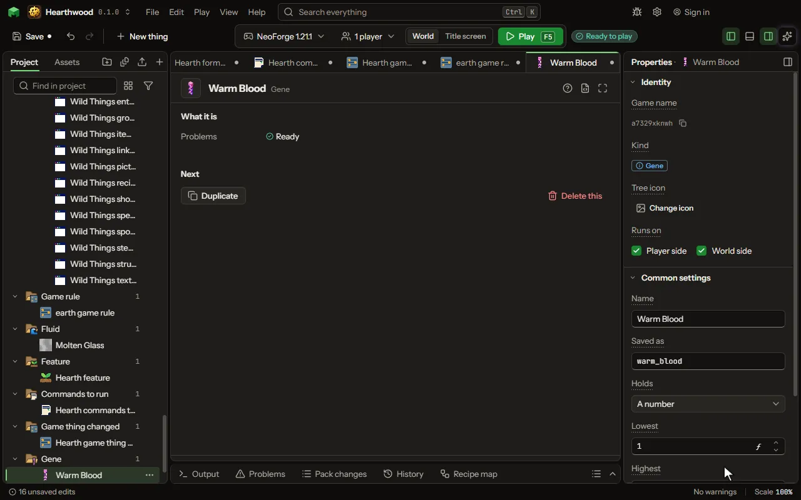

# Gene editor

A trait any thing can carry and pass to its young: a number such as Growth, or one of a few choices such as Coat colour.

## How to add it

- New thing > Blocks and items > Gene

## What you can set

| Setting | What it does |
| --- | --- |
| Name | What a player reads in a tooltip and in the chat. |
| Saved as | The name the gene is kept under on each thing, and what rules call it. |
| Holds | A number in a range, such as Growth from 1 to 10, or one of a few choices, such as Black, Orange or White. Choose one of: A number, One of a few choices. |
| Lowest | The smallest the number can be. From -1000000 to 1000000. |
| Highest | The biggest the number can be. From -1000000 to 1000000. |
| Starts at | What a thing has when its species does not say. From -1000000 to 1000000. |
| Step | The number moves in steps of this much: 1 for whole numbers, 0 for any. From 0 to 1000000. |
| Choices | Each value the gene can take, which one wins when a thing has two, and how often it is found in the wild. Each row has: Value, Wins, In the wild, Block. |
| A child takes it | How a child gets this gene from its two parents. Choose one of: One copy from each parent, The parents' average, From one parent or the other, The higher of the two, The lower of the two. |
| Of two copies, shows | Which of its two numbers it shows. Choose one of: The higher, The lower, Their average, The first. |
| Chance to change | Out of every hundred children, how many have this gene changed: a number moves by a step, a choice turns into another. From 0 to 100 percent. |
| Changes by | How much the number moves when it changes. From 0 to 1000000. |
| Changes | Which way the number moves when it changes. Choose one of: Up, Down, Up or down. |
| Carried once when | Another gene, such as Sex: where it shows the value below, this gene is carried once, the mother's copy, as orange is on a tomcat. |
| Shows | The value of that gene with which this one is carried once, such as Male. |
| Shapes | What this number changes in the thing that carries it: how fast a plant grows, how much a block drops, how tall a tree grows, or a mob's size, speed or health. Choose one of: Nothing, How fast it grows, How much it drops, How tall a tree grows, Its size, Its speed, Its health, How wide its trunk grows, How big its crown grows. |
| Each point above the start | How much more, out of a hundred, each point above the gene's start gives, and less for each point below. At 10, a plant with Growth 5 and a start of 2 grows 30 in a hundred faster. From -100 to 1000 percent. |
| Decides in a tree | What this choice decides in a tree grown from a sapling that carries it: the fruit it bears, its logs, its leaves, or the shape of its crown (name the choices round, pointed, wide or bush). Choose one of: Nothing, The fruit it bears, Its logs, Its leaves, The shape of its crown. |
| Shown | When the tooltip and the chat say it. Choose one of: Always, Once read by an analyser, Never. |

## What it becomes in the game

It runs on the player's side of the game.

## What it works with

It points at: [Block](editor-block.md).

These point at it: [Machine recipe](editor-machineRecipe.md), [Species](editor-species.md).

## Picture

## Related pages

- [Gene](thing-gene.md)
- [Glossary](glossary.md)
