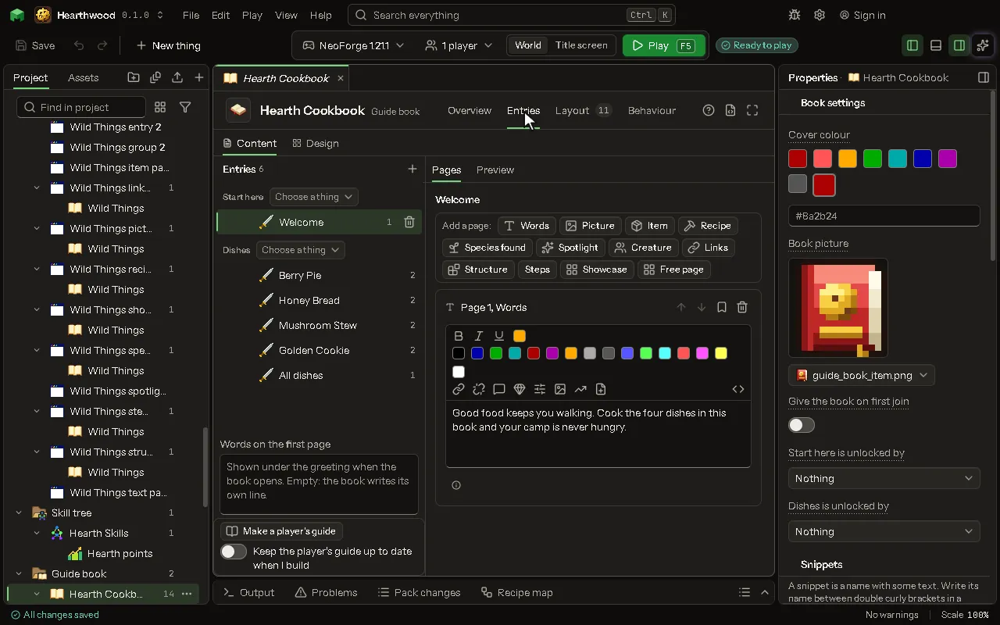

# Guide book editor

A book of pages about the mod: words, pictures, items and recipes.

## How to add it

- New thing > Screens and guides > Guide book

## What you can set

| Setting | What it does |
| --- | --- |
| Name | What you call it here, and the book's title in the game. |
| Game name | The name the mod knows it by. Lowercase letters, numbers and underscores. |
| Entries | Its entries and their pages, written on the Entries tab. |
| Layout | Where everything on the screen is, laid out on the Layout tab. |
| Button on the inventory | A button with its icon on the game's own inventory screen, survival and creative, that opens it: a way in with no item needed, beside an item, a key or a command. |
| Its icon | The item drawn on the button on the inventory. |
| Where it sits | Where the button sits: at a corner of the window, in a row with the other buttons there, as a quest mod's does; or by the inventory, above it at either end or beside it, moving with it when the recipe book opens. Choose one of: Top left of the window, Top right of the window, Bottom left of the window, Bottom right of the window, Above, at the left, Above, at the right, Beside it, on the left, Beside it, on the right. |
| Its look | The icon alone, lit when pointed at, as a quest mod's is; or the icon on a dark rounded button. Choose one of: The icon alone, On a dark button. |

## What it becomes in the game

It is not part of the game itself: it describes another mod or a file, so it has no side to choose.

## What it works with

It does not point at other things.

These point at it: [Behavior](editor-behaviour.md).

## Picture

## Related pages

- [Guide book](thing-guideBook.md)
- [Glossary](glossary.md)
