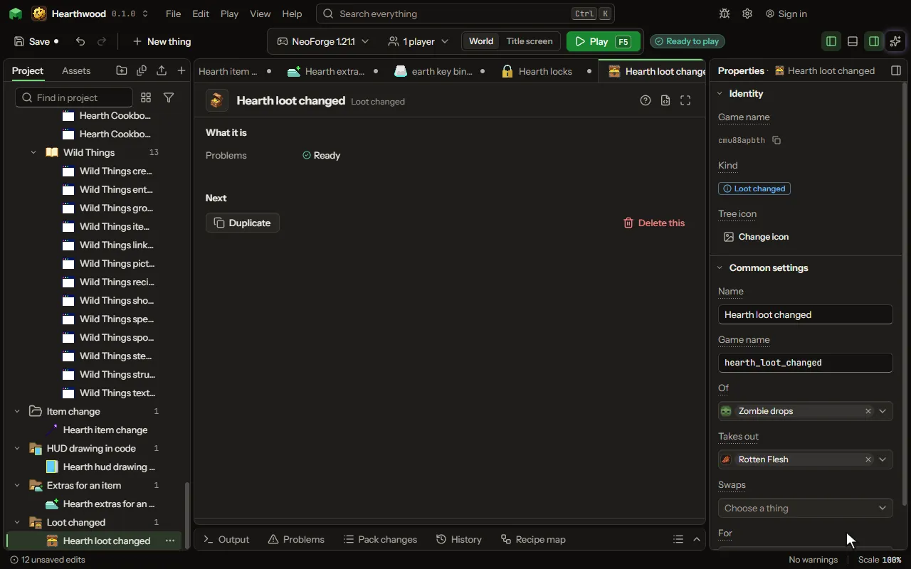

# Loot changed editor

What the game's own blocks, mobs and chests drop, changed in place: things taken out, or one thing given in place of another.

## How to add it

- New thing > Crafting and loot > Loot changed

## What you can set

| Setting | What it does |
| --- | --- |
| Name | What it is called here. |
| Game name | Its name inside the game, in small letters. |
| Of | The game's loot tables it changes: a block's, a mob's, a chest's, fishing. |
| Takes out | Things they no longer drop. |
| Swaps | One thing they drop given as another, as many of it: gunpowder as sugar. |
| For | One thing they drop given as another, as many of it: gunpowder as sugar. |

## What it becomes in the game

It is not part of the game itself: it describes another mod or a file, so it has no side to choose.

## What it works with

It does not point at other things.

## Picture

## Related pages

- [Loot changed](thing-lootChange.md)
- [Glossary](glossary.md)
