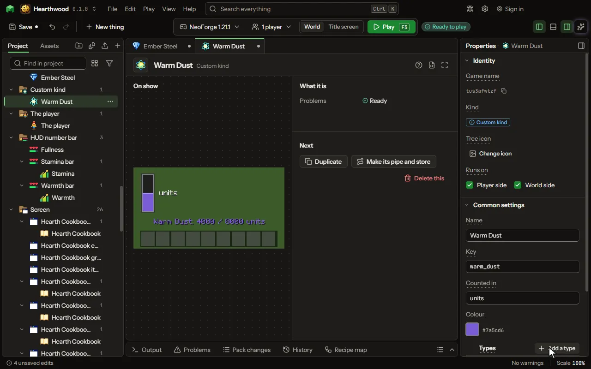

# Custom kind editor

A matter of your own beside energy and fluid: a chemical, mana, heat, whatever your mod calls it. Blocks hold it in tanks, pipes and channels carry it, rules move it and moving parts show it.

## How to add it

- New thing > Machines and networks > Custom kind
- New thing > Machines and networks > Chemicals

## What you can set

| Setting | What it does |
| --- | --- |
| Name | What players call it, as it is shown. |
| Key | The name blocks keep it under, as the game keeps it with your mod's id in front. |
| Counted in | The word for one of it, shown after its amount: mana, units, degrees. |
| Colour | The colour it is drawn in where it shows. |
| Types | The types of it, each with a name and a colour: oxygen and hydrogen of a gas, fire and water of a magic essence. A tank of it takes any one type at a time, unless it names one. Each row has: Name, Key, Colour, Made of. |
| Held by things | How much of each type things hold: an item, a block or a mob by its name or by a tag. A thing's own line wins over its tags' lines; a 0 takes a type away. Each row has: Thing, Type, Amount. |
| Kept by another mod | The name of another mod made here whose kind this is, the same game name and types. Your pipes then fill and empty that mod's blocks of it, and its pipes yours. |
| Kept by its handler | Use another mod's real tanks and machines for this kind. Write the name that mod gives its handler, with the mod's name in front, or pick the ready-made entry. Leave it empty to not use one. Nothing is built against that mod: when it is not installed, nothing happens. |
| Handler type | The full Java type of that handler, as the mod's page or code shows it. Needed to find it by name; the mod's page or code shows it. |
| Call that puts in | The name of the handler's call that puts stock in. The ready-made entry shows one. It is given the thing, how much, and whether to only try. |
| Putting in answers with | What that call gives back: how much went in (accepted), or how much did not fit (left over). Choose one of: How much went in, How much did not fit. |
| Call that takes out | The name of the handler's call that takes stock out. The ready-made entry shows one. It must give back how much came out. |
| Call that reads | Optional. The name of a call that tells how full the handler is: a number from 0 to 1, or any amount for something in it. Empty counts it as full. |
| Where their things are | Only when the calls want the other mod's own stack of a thing. The class and field of the list to find it in, written class#FIELD, as the Mekanism entry shows. A type key without a mod name gets the handler's mod name. |
| Theirs to one of ours | How many of their units make one of yours. 1 means one for one. From 1 to 1000000. |
| On the tooltip | When an item's tooltip lists what it holds of these types. Choose one of: Never, Always, While the player crouches, While holding or wearing an item. |
| Item that shows it | The item in either hand or on the head that lets a player see what things hold, like goggles. |

## What it becomes in the game

It is written into the mod when you Cook or press Play.

## What it works with

It does not point at other things.

These point at it: [Machine recipe](editor-machineRecipe.md), [Station recipe](editor-stationRecipe.md).

## Picture

## Related pages

- [Custom kind](thing-matter.md)
- [Chemicals](thing-chemicals.md)
- [Glossary](glossary.md)
