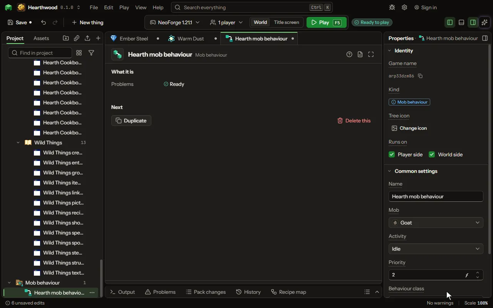

# Mob behaviour editor

A piece of your own code that joins one activity of a mob's brain, the game's or another mod's.

## How to add it

- New thing > Mobs and models > Mob behaviour

## What you can set

| Setting | What it does |
| --- | --- |
| Name | What you call it in the project. |
| Mob | The mob, chosen from the game's mobs and your own. |
| Activity | The activity of its brain the behaviour joins, such as ram for a goat's charge. Choose one of: Always (core), Idle, Work, Play, Rest, Meet, Panic, Raid, Before a raid, Hide, Fight, Celebrate, Admire an item, Avoid, Ride, Play dead, Long jump, Ram, Tongue, Swim, Lay spawn, Sniff, Investigate, Roar, Emerge, Dig. |
| Priority | Where it runs among the activity's behaviours: a lower number first. |
| Behaviour class | Your class's full name; it is made once for each mob, with no arguments. |
| Conditions | When the activity may run, one a line: a memory and present, absent or registered, such as tempting_player absent. They stand in for the activity's own, so list the game's too. |

## What it becomes in the game

It is written into the mod when you Cook or press Play.

## What it works with

It does not point at other things.

## Picture

## Related pages

- [Mob behaviour](thing-mobBehaviour.md)
- [Glossary](glossary.md)
