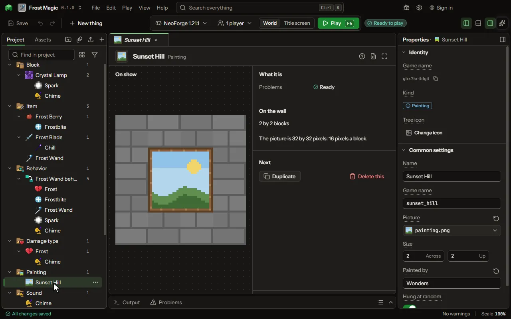

# Painting editor

A picture hung on a wall.

## How to add it

- New thing > Mobs and models > Painting

## What you can set

| Setting | What it does |
| --- | --- |
| Name | The painting's title, which the game shows over it in the painting's list. |
| Game name | The painting's name in the game, as a command or a data pack names it. |
| Picture | What is painted. The game draws sixteen pixels a block, so a picture two blocks by two is thirty two pixels square; more pixels a block are finer. |
| Across | How many blocks it covers on the wall, across and up. The game's own go from one by one to four by four. From 1 to 16 blocks. |
| Up | How many blocks it covers on the wall, across and up. The game's own go from one by one to four by four. From 1 to 16 blocks. |
| Painted by | Whose painting it is, shown under the title. Left empty, no one is named. |
| Hung at random | Whether the game's own painting item may hang it when a player places one. Off, only a painting of it given by name hangs it. |

## What it becomes in the game

It is not part of the game itself: it describes another mod or a file, so it has no side to choose.

## What it works with

It does not point at other things.

## Picture

## Related pages

- [Painting](thing-painting.md)
- [Glossary](glossary.md)
