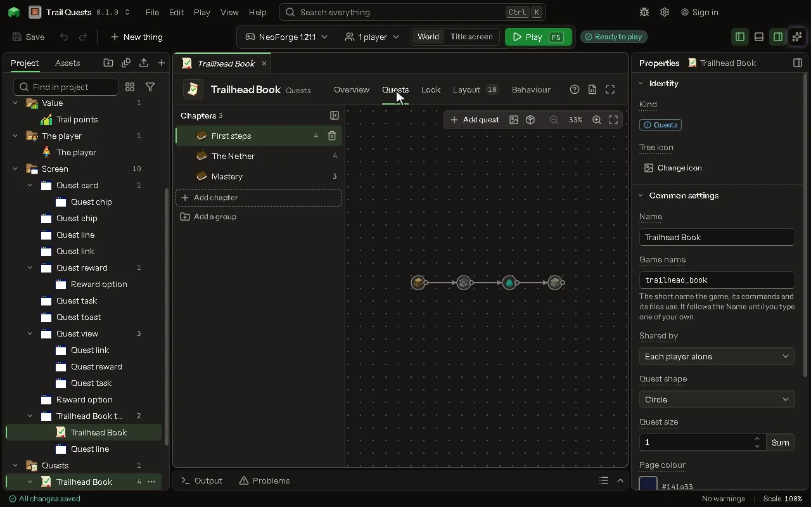

# Quests editor

Chapters of quests a player finishes for rewards, read in a book of the mod's own, each quest placed on its chapter's page.

## How to add it

- New thing > Screens and guides > Quests

## What you can set

| Setting | What it does |
| --- | --- |
| Name | What you call it here, and the book's title in the game. |
| Game name | The name the mod knows it by. Lowercase letters, numbers and underscores. |
| Shared by | Whose progress it is: each player's alone, or shared by the players of one team (the game's own teams). Choose one of: Each player alone, The player's team. |
| Quests | Its chapters and quests, laid out on the Quests tab. |
| Layout | Where everything on the screen is, laid out on the Layout tab. |
| Quest shape | The outline a new quest is drawn in. A chapter may choose its own, and a quest its own. Choose one of: Circle, Square, Rounded square, Diamond, Hexagon, Octagon, Pentagon, Heart, Gear, No outline. |
| Quest size | How big a new quest is drawn, 1 the ordinary size, from a half to four. A chapter may choose its own, and a quest its own. From 0.5 to 4. |
| Page colour | The colour behind the quests. Leave it as it is to keep the ordinary one. |
| Page picture | A picture from your project drawn behind the quests, over the page colour. |
| Show the grid | The dots behind the quests that help the eye. |
| Line colour | The colour of the lines that join one quest to the next. |
| Done quests | The colour of a quest the player has finished. |
| Open quests | The colour of a quest the player can do now. |
| Locked quests | The colour of a quest that is not open yet. |
| Text colour | The colour of the words on the page. |
| Text size | How big the words are, 1 the ordinary size, from a half to double. From 0.5 to 2. |
| Rewards claimed by | In a book a team shares: whether each player of the team claims a reward for themselves, or the team claims it once. A reward may choose its own. Choose one of: Each player, The team, once. |
| Locked | The book shows its lock message and no quest counts until an operator unlocks it for a player with /<book> unlock. |
| Lock message | The words the book shows while it is locked. |
| Opens on | Straight into its first chapter, or first on a screen of yours whose buttons open the book at a chapter or a quest. That screen's Back button returns to it. |
| Button on the inventory | A button with its icon on the game's own inventory screen, survival and creative, that opens it: a way in with no item needed, beside an item, a key or a command. |
| Its icon | The item drawn on the button on the inventory. |
| Where it sits | Where the button sits: at a corner of the window, in a row with the other buttons there, as a quest mod's does; or by the inventory, above it at either end or beside it, moving with it when the recipe book opens. Choose one of: Top left of the window, Top right of the window, Bottom left of the window, Bottom right of the window, Above, at the left, Above, at the right, Beside it, on the left, Beside it, on the right. |
| Its look | The icon alone, lit when pointed at, as a quest mod's is; or the icon on a dark rounded button. Choose one of: The icon alone, On a dark button. |
| Toast for a quest done | The game's own toast, in the book's colors, when the player finishes a quest. |
| Toast for a chapter done | A toast when the player finishes every quest of a chapter. |
| Toast for the book done | A toast when the player finishes the whole book. |
| Toast for a reward | A toast for each reward the player is given. |

## What it becomes in the game

It is not part of the game itself: it describes another mod or a file, so it has no side to choose.

## What it works with

It points at: [Screen](editor-screen.md).

These point at it: [Behavior](editor-behaviour.md).

## Picture

## Related pages

- [Quests](thing-questBook.md)
- [Glossary](glossary.md)
