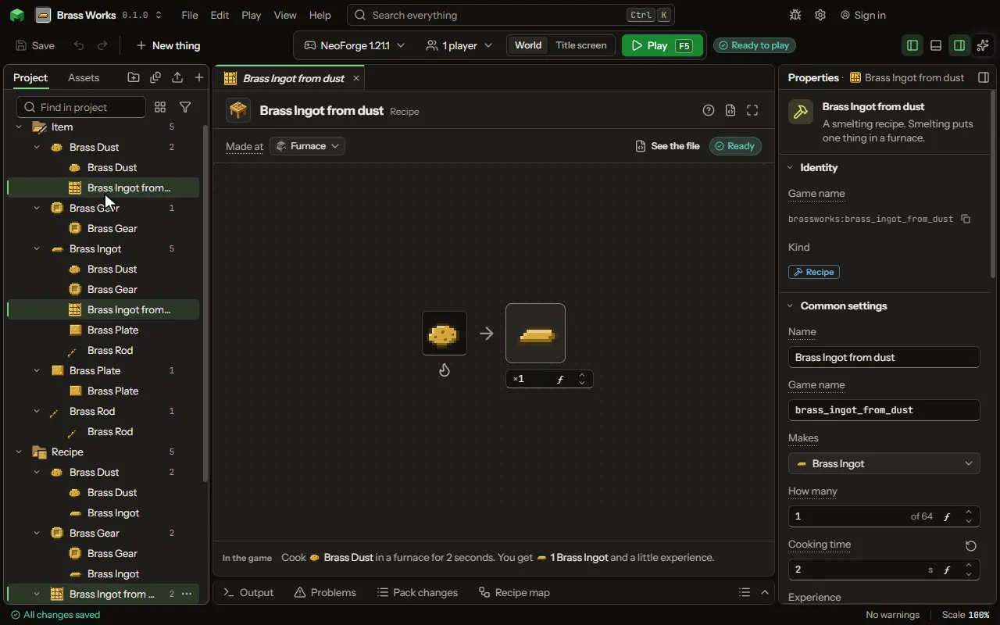

# Recipe editor

Make something in a crafting table, furnace, stonecutter or smithing table.

## How to add it

- New thing > Crafting and loot > Recipe

## What you can set

| Setting | What it does |
| --- | --- |
| Name | A name for you. Players never see it. |
| Recipe id | The file name inside the mod. Lowercase letters, digits and underscores. |
| Shape | Shaped keeps the things where you put them in the grid. Shapeless only cares which things are used. Smelting puts one thing in a furnace. Choose one of: Shaped, Shapeless, Smelting, Blasting, Smoking, Campfire, Stonecutting, Smithing, Trim, Transmute, Dye, Imbue, Brewing, Raw recipe. |
| Makes | What comes out of the crafting table. |
| How many | How many come out each time. From 1 to 64. |
| Slot | What goes in this slot of the crafting grid. Leave it empty for nothing. |
| Slot | What goes in this slot of the crafting grid. Leave it empty for nothing. |
| Slot | What goes in this slot of the crafting grid. Leave it empty for nothing. |
| Slot | What goes in this slot of the crafting grid. Leave it empty for nothing. |
| Slot | What goes in this slot of the crafting grid. Leave it empty for nothing. |
| Slot | What goes in this slot of the crafting grid. Leave it empty for nothing. |
| Slot | What goes in this slot of the crafting grid. Leave it empty for nothing. |
| Slot | What goes in this slot of the crafting grid. Leave it empty for nothing. |
| Slot | What goes in this slot of the crafting grid. Leave it empty for nothing. |
| Cooking time | How long it cooks. 0 is the game's own time for this kind: 10 seconds in a furnace, 5 in a blast furnace or smoker, 30 on a campfire. From 0 to 3600 seconds. |
| Experience | The experience a player gets taking it out of a furnace. From 0 to 100. |
| Potion in the bottle | The potion that goes in. Leave it empty to turn a plain bottle item into the result item. |
| Potion that comes out | The potion the bottle becomes. Choose both potions to make a potion mix, for example awkward potion plus glowstone. |
| Trim pattern | The pattern the trim draws (from 1.21.5). Empty: the one the template is named for. |
| Also gives | More things a crafting grid gives with the result, each by its own chance. They come back as leftovers do: into the grid, else into the inventory; a crafter puts them out. On a furnace, blast furnace or smoker recipe they are given when you take the result out. Each row has: Thing, How many, Chance. |
| After crafting | What is left in a slot when the recipe is made. By default a thing is used up. It can stay, lose some durability (it breaks when worn out), or turn into another item. Each row has: Slot, Then it, Durability lost, Becomes. |
| Result from the inputs | How what it makes takes its data from what went in, in order: its enchantments, name, wear or colour, all its data, or the inputs' durability added up. Each row has: Takes, From, Bonus. |
| Slots with a rule | A slot that takes anything that passes a test instead of one thing: any of a list, anything with a tag, a value of at least so much, some data, or a gene. Each row has: Slot, Takes, Which, At least, The data is, But not. |
| Worked out from the inputs | What the result works out from what went in, each by a formula over the inputs' values: a value it holds, how many it makes, an effect and its strength, which thing it is, or an input's contents kept. Or all the parts kept inside it, so a robot built from them starts with them in its bag. Each row has: Works out, Which, Formula, Seconds. |
| Make one for every | Writes this recipe once for everything in the set you pick: dye colours, wood types, stone types, metals, gems, or a list of your own. Where the recipe says (each) (or <colour>, <wood>, <stone>), each one's name goes; one the game lacks is left out. |
| Loads only when | Whether the recipe exists at all. It is decided once, when the game loads, so a recipe for a mod that is not there is simply left out. This is not about the moment of crafting: use Works only when for that. Each row has: The pack, Name. |
| Add its mods by itself | When the recipe uses another mod's item or tag, it is loaded only when that mod is in the pack. Turn this off to load it always. |
| Works only when | The recipe only works when this holds: at night, in a biome, in some weather, after an advancement, when a setting is on, or what is around the place it is made. Every row must hold. Each row has: When, Block, Value, Dimension, Weather, Name, Setting, At least, At most, Hours, At least, At most, Blocks away, Turned round. |
| Only while a number > 0 | For advanced rules: a number worked out where the recipe is made. The recipe works only while the number is above 0. Make it a formula to use any piece of the rules. |
| Show in recipe viewers | When this recipe works out its result from what goes in, the recipe viewers show a page for it: the inputs, the result and a line saying how it is made. Turn it off to keep the page out. |
| Example inputs for the page | The things the page draws as the inputs, separated by commas. Leave it empty to draw the first thing each slot takes. |
| Raw recipe | The studio has no picture for this kind of recipe. Its text below goes into your mod exactly as written. |
| Takes the place of | Pick a game recipe this one replaces. The game's own one is then gone. |
| Result name | A name for the thing this recipe gives. Leave it empty to keep the item's own name. |
| Lore lines | Lines of grey text under the name, one line each. Each row has: Line. |
| Enchantments | Enchantments the thing comes with when it is crafted. Each row has: Enchantment, Level. |
| Never breaks | The thing made by this recipe never loses durability. |
| Custom model number | A number a resource pack can use to give this copy its own look. 0 means none. From 0 to 100000000. |
| Other item data | Anything else the thing should carry, written as a JSON object with quoted names. It is added last, so it wins over the fields above. |
| Shares a book slot with | Recipes with the same group word show as one slot in the recipe book. Pick one that exists or type a new word. |
| Recipe book tab | The tab of the recipe book this recipe shows under. Choose one of: Building, Redstone, Equipment, Other. |
| Recipe book tab | The tab of the furnace's recipe book this recipe shows under. Choose one of: Food, Blocks, Other. |
| Show a note when unlocked | A small note pops up when the player learns this recipe. The game does this by default. |

## What it becomes in the game

It is written into the mod when you Cook or press Play.

## What it works with

It points at: [Potion](editor-potion.md), [Block](editor-block.md), [Area value](editor-areaValue.md), [Mod settings](editor-configValue.md).

## Picture

## Related pages

- [Recipe](thing-recipe.md)
- [Glossary](glossary.md)
