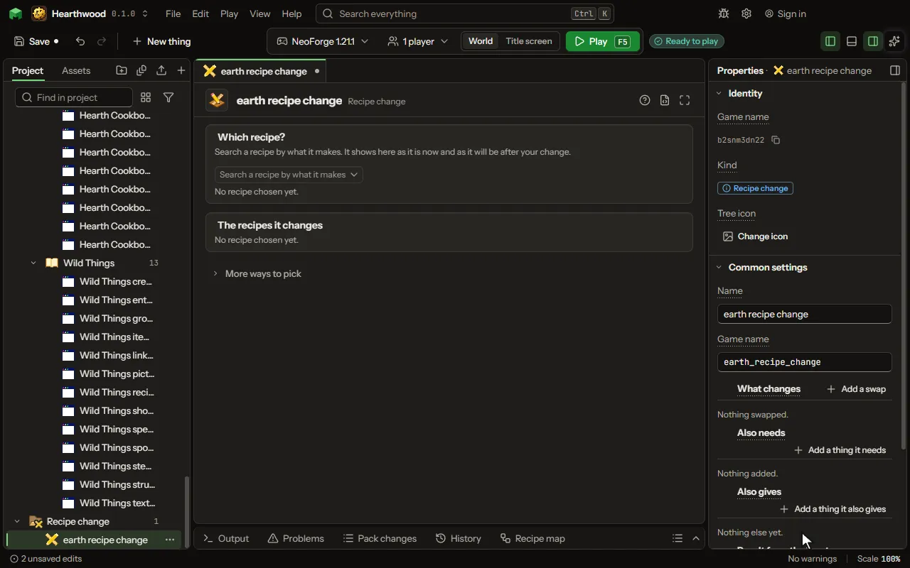

# Recipe change editor

Change a recipe the game or another mod already has. Swap an input or the result, add inputs or extras.

## How to add it

- New thing > Crafting and loot > Recipe change

## What you can set

| Setting | What it does |
| --- | --- |
| Name | What it is called here. |
| Game name | Its name inside the game, in small letters. |
| Recipes | The recipes this changes: the game's, or those of a mod you build on. Find them by what they make or use, then read them. |
| Rule | The tests that pick recipes, kept as text. Change them in the editor. |
| Folder of the pack's mods | The folder with the mod files of your pack. Every recipe in them counts too. Leave it empty to use the game and the mods this project is built on. |
| Recipes the rule picked | The ids the rule picked when you last pressed Use these recipes. The build writes these. |
| What changes | A thing put in place of another wherever the recipe names it. Each row has: Swap, for, in. |
| Also needs | Things the recipe needs as well: in a shapeless recipe's list, or in the first free cell of a shaped grid. Each row has: Slot. |
| Also gives | More things a crafting grid gives with the result, each by its own chance. They come back as leftovers do: into the grid, else into the inventory; a crafter puts them out. On a furnace, blast furnace or smoker recipe they are given when you take the result out. Each row has: Thing, How many, Chance. |
| Result from the inputs | How what it makes takes its data from what went in, in order: its enchantments, name, wear or colour, all its data, or the inputs' durability added up. Each row has: Takes, From, Bonus. |
| As read | Each recipe as the game or the other mod has it, read when you pressed Read the recipes. The change is made on this. |

## What it becomes in the game

It is not part of the game itself: it describes another mod or a file, so it has no side to choose.

## What it works with

It does not point at other things.

## Picture

## Related pages

- [Recipe change](thing-recipeChange.md)
- [Glossary](glossary.md)
