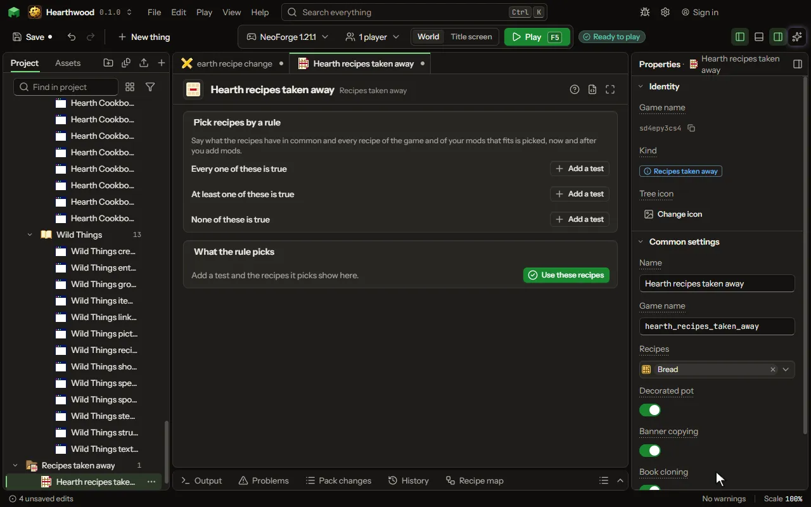

# Recipes taken away editor

Take recipes the game has out of the game.

## How to add it

- New thing > Crafting and loot > Recipes taken away

## What you can set

| Setting | What it does |
| --- | --- |
| Name | What it is called here. |
| Game name | Its name inside the game, in small letters. |
| Recipes | The game's recipes that are gone: a crafting table, a furnace and every recipe viewer no longer know them. |
| Decorated pot | On keeps the game's special recipe. Off takes it away. |
| Banner copying | On keeps the game's special recipe. Off takes it away. |
| Book cloning | On keeps the game's special recipe. Off takes it away. |
| Firework rocket | On keeps the game's special recipe. Off takes it away. |
| Firework star | On keeps the game's special recipe. Off takes it away. |
| Firework star fade | On keeps the game's special recipe. Off takes it away. |
| Map extending | On keeps the game's special recipe. Off takes it away. |
| Shield decoration | On keeps the game's special recipe. Off takes it away. |
| Tipped arrow | On keeps the game's special recipe. Off takes it away. |
| Repairing by crafting | On keeps the game's special recipe. Off takes it away. |
| Suspicious stew | On keeps the game's special recipe. Off takes it away. |
| Armor dyeing | On keeps the game's special recipe. Off takes it away. |
| Map cloning | On keeps the game's special recipe. Off takes it away. |
| Rule | The tests that pick recipes, kept as text. Change them in the editor. |
| Folder of the pack's mods | The folder with the mod files of your pack. Every recipe in them counts too. Leave it empty to use the game and the mods this project is built on. |
| Recipes the rule picked | The game names the rule picked when you last pressed Use these recipes. The build writes these. |

## What it becomes in the game

It is not part of the game itself: it describes another mod or a file, so it has no side to choose.

## What it works with

It does not point at other things.

## Picture

## Related pages

- [Recipes taken away](thing-recipesRemoved.md)
- [Glossary](glossary.md)
