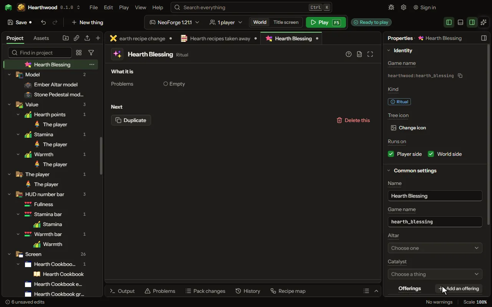

# Ritual editor

Offerings on pedestals around an altar, a catalyst on the altar, the conditions it asks, and the result it leaves on the altar.

## How to add it

- New thing > Crafting and loot > Ritual

## What you can set

| Setting | What it does |
| --- | --- |
| Name | What the ritual is called in the studio. |
| Game name | The ritual's name in the game's data. |
| Altar | The block that performs it: any block that performs rituals. Rituals name their altar, so adding one changes no block. |
| Catalyst | The item that must lie on the altar. It becomes the result. |
| Offerings | One item a pedestal, in any order. Every pedestal within reach that holds an item must hold one of these. Each row has: Offering. |
| Result | What lies on the altar when the ritual is done. |
| How many | How many of the result it leaves. From 1 to 64. |
| Seconds | How long it takes. The offerings are taken one by one over this time. From 1 to 600 seconds. |
| When | The time of day it may be started in. Choose one of: any time, by day, by night. |
| Levels it costs | Levels of experience the player who starts it pays. A player without them cannot start it. From 0 to 100. |
| Works only when | The recipe only works when this holds: at night, in a biome, in some weather, after an advancement, when a setting is on, or what is around the place it is made. Every row must hold. Each row has: When, Block, Value, Dimension, Weather, Name, Setting, At least, At most, Hours, At least, At most, Blocks away, Turned round. |
| Only while a number > 0 | For advanced rules: a number worked out where the recipe is made. The recipe works only while the number is above 0. Make it a formula to use any piece of the rules. |
| Particles | What streams from each offering into the altar while it is performed. Choose one of: flame, smoke, heart, crit, portal, happy, soul, snow, enchanting letters, music notes, angry clouds, white clouds, bubbles, a witch's sparkle, a totem's burst, a sword's sweep, end rod sparks, glow squid light, wax flecks, electric sparks, sculk souls, water drops. |
| Sound | The sound it starts with and takes each offering with. Choose one of: fire crackle, thunder, explosion, anvil, bell, level up, hurt, pop, a door opening, a chest opening, experience picked up, a button click, a villager agreeing, a villager refusing, an enderman's teleport, a portal's hum, a splash, eating, a burp, the wither's arrival, the dragon's growl, a totem saving a life, an amethyst chime, a harp note. |

## What it becomes in the game

It is written into the mod when you Cook or press Play.

## What it works with

It points at: [Block](editor-block.md), [Area value](editor-areaValue.md), [Mod settings](editor-configValue.md).

## Picture

## Related pages

- [Ritual](thing-ritual.md)
- [Glossary](glossary.md)
