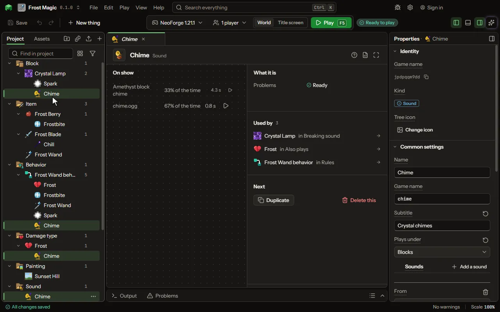

# Sound editor

A sound the game plays.

## How to add it

- New thing > Mobs and models > Sound

## What you can set

| Setting | What it does |
| --- | --- |
| Name | A name for you. Players read its subtitle. |
| Game name | The sound's name in the game, as /playsound and another mod name it. |
| Subtitle | What a player with subtitles on reads while it plays. Left empty, it is the sound's name. |
| Plays under | The slider in the game's Music and Sounds screen that makes it louder or quieter: a block's sounds under Blocks, a creature's under Friendly or Hostile Creatures, a rule's played for a player under Players. Choose one of: Master volume, Music, Jukebox and note blocks, Weather, Blocks, Hostile creatures, Friendly creatures, Players, Ambient, Voice and speech. |
| Sounds | One of these plays each time, as likely as its weight against the others, as a block's footsteps vary. Each row has: From, File, Game's sound, Weight, Volume, Pitch, Heard up to, Stream it. |

## What it becomes in the game

It is not part of the game itself: it describes another mod or a file, so it has no side to choose.

## What it works with

It does not point at other things.

These point at it: [Block](editor-block.md), [Mob](editor-creature.md), [Damage type](editor-damageType.md), [Villager job](editor-villagerProfession.md), [Biome](editor-biome.md).

## Picture

## Related pages

- [Sound](thing-sound.md)
- [Glossary](glossary.md)
