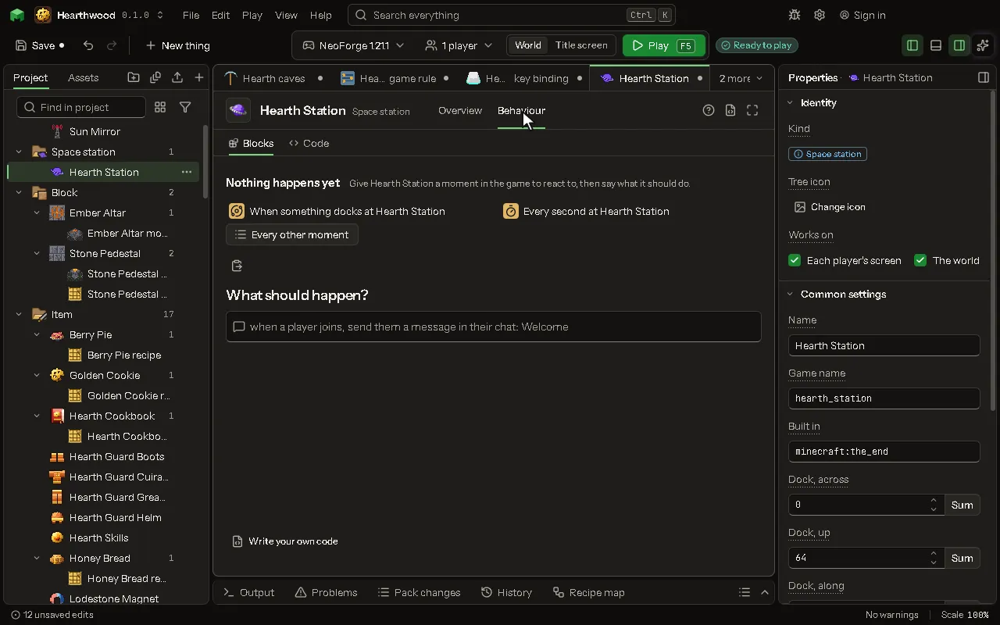

# Space station editor

A built place in a dimension of its own that anyone or any vehicle docks with, orbiting a world at a height that rules move. Build the region where you like and say where the dock is.

## How to add it

- New thing > Blocks and items > Space station

## What you can set

| Setting | What it does |
| --- | --- |
| Name | The name of the station, as you and your players know it. |
| Game name | The station's name inside the game files. Lower case letters, numbers and underscores. |
| Built in | The dimension the station stands in: your space dimension. |
| Dock, across | Where arrivals stand: the block across (x). From -30000000 to 30000000. |
| Dock, up | Where arrivals stand: the height (y). From -2048 to 2048. |
| Dock, along | Where arrivals stand: the block along (z). From -30000000 to 30000000. |
| Orbits | The world below it. Sending someone down lands them on the ground of this dimension. |
| Starts at height | How high above that world the station is when the world is new. From 0 to 1000000000 blocks. |
| Lowest height | It cannot fall below this. At this height rules can bring it down. From 0 to 1000000000 blocks. |
| Highest height | It cannot climb above this. From 0 to 1000000000 blocks. |
| Falls a second | How much height it loses by itself each second, an orbit that decays. Nought: it stays where it is until a rule moves it. From 0 to 1000000000 perSecond. |

## What it becomes in the game

It runs on the player's side of the game.

## What it works with

It does not point at other things.

These point at it: [Behavior](editor-behaviour.md).

## Picture

## Related pages

- [Space station](thing-spaceStation.md)
- [Glossary](glossary.md)
