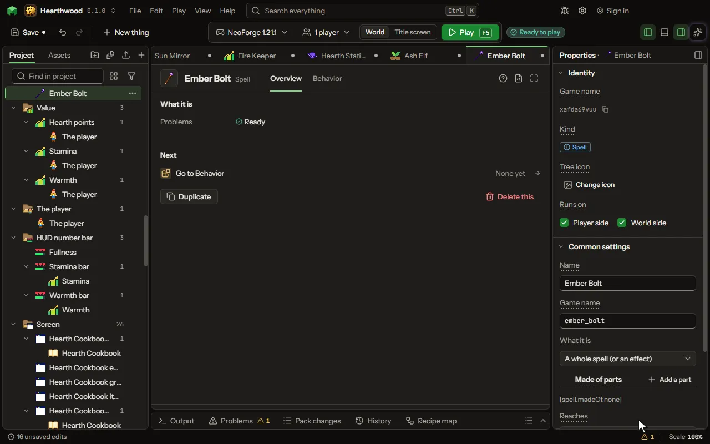

# Spell editor

A spell of its own: what it does as rules (when it is cast, when it reaches a mob or a block, every tick it is kept up), what it costs (mana or any value), its cooldown and charge-up, and how it reaches: on the caster, along a ray, as a missile or all around. Cast by a wand, a scroll, any rule or a creature.

## How to add it

- New thing > Blocks and items > Spell

## What you can set

| Setting | What it does |
| --- | --- |
| Name | What the spell is called in the game. |
| Game name | The spell's id in the game; another mod casts it by this. |
| What it is | A whole spell, or a part a spell is put together from: a medium says how a made spell reaches, a modifier changes it. A whole spell is also the part that says what a made spell does. Choose one of: A whole spell (or an effect), A medium (how it reaches), A modifier (what changes it). |
| Made of parts | Put this spell together from parts: a medium, effects (whole spells, this mod's or another mod's) and modifiers. Their costs add up and every part's moments run. Empty: it is a spell of its own. Each row has: Part. |
| Reaches | How it reaches what it does: the caster alone, what the caster touches, along where the caster looks, as a projectile, every mob around, or as a construct left where its ray ends. Choose one of: On the caster, By touch, Along a ray, As a missile, All around, Left in the world. |
| Range | How far its ray goes, or how wide its area is, in blocks. From 1 to 128 blocks. |
| Missile | What it fires: one of the game's, or a projectile of the mod's own. Its hit is the spell's hit. Choose one of: Small fireball, Fireball, Arrow, Snowball, Wither skull. |
| Construct | What it leaves where its ray ends: a ward hits everything inside it again and again, a trap waits for the first to come in and hits once, a sentinel hits the nearest one in reach. Choose one of: A ward (hits all inside, again and again), A trap (waits, hits once), A sentinel (hits the nearest). |
| Stays for | How long the construct stays in the world, in seconds. From 0.05 to 3600 seconds. |
| Acts every | How often a ward or a sentinel hits, in seconds. From 0.05 to 600 seconds. |
| Construct size | How far from its middle the construct reaches, in blocks. From 0.5 to 32 blocks. |
| Construct hits | Whom the construct hits: monsters alone, or every living thing but the one who cast it. Choose one of: Monsters, Everyone but the caster. |
| Split into | How many more copies of it go out as it is cast, fanned out to the sides: a split bolt, a fan of rays. From 0 to 16. |
| Power more | How much stronger it makes the spell, in a hundred: 50 is half as strong again. The power is handed to every moment of the spell. From -100 to 1000 percent. |
| Range more | How much further it makes the spell reach, and a construct wider, in a hundred. From -100 to 1000 percent. |
| Time more | How much longer it makes a kept-up spell and a construct last, in a hundred. From -100 to 1000 percent. |
| Copies more | How many more copies of the spell go out, fanned to the sides. From 0 to 16. |
| Cost more | How much more the whole made spell costs, in a hundred; below nought makes it cheaper. From -100 to 1000 percent. |
| Part item | The item that stands for it when a player puts a spell together in a block with slots (a rune, a herb, a focus), with the Make a spell word. |
| Costs | The value it is paid from: the player's mana, or a value the item that casts it keeps (a wand's charge). None makes it free. |
| Cost | How much of that value one cast takes; a kept-up spell takes this much a second. From 0 to 1000000000. |
| Cooldown | How long before it can be cast again, in seconds. From 0 to 3600 seconds. |
| Charge-up | How long the use is held before it goes, in seconds. From 0 to 60 seconds. |
| Grows while held | It goes when the use is let go, stronger the longer it was held, up to its charge-up time. |
| Power at full charge | How many times its own power it has when held for its whole charge-up. From 1 to 100. |
| Kept up | It goes on while the use is held, its moment every tick and its cost a second at a time: a beam, a stream of fire. |
| Lasts at most | How long it can be kept up at a time, in seconds; nought keeps it up while it can be paid. From 0 to 600 seconds. |
| Must be learned | Only a player who has learned it casts it (a spell book teaches it, or the Teach a spell word). |
| Kit | The kit it belongs to: a wand takes the spells of its kit. Empty is this mod's own; another mod's kit by its name adds the spell to that mod's wands. |
| Costs (another mod's) | A value typed by its name: another mod's (when the spell is paid from the mod it adds to), or the game's own: xp (experience points), levels, health or food. |
| Also takes | An item each cast takes from the caster's inventory (a reagent, a herb); none takes nothing. |
| How many | How many of that item each cast takes. From 1 to 64. |
| Also spends a stock | A stock of your own (matter held in items: a gas, an essence, mana in a jar) that each cast uses up from the items the caster carries. Pick a kind for any type of it, or one type. |
| How much of the stock | How much of the stock each cast spends. An item is used whole, so a little may be lost; with too little carried, the spell does not go. From 1 to 1000000. |
| Element | A word that sorts it: fire, ice, lightning, healing. |
| Tier | How strong it is, 1 to 10; a wand casts up to its own tier. From 1 to 10. |
| Trail | The particles along its ray, around its area, and around the caster while it charges. Choose one of: None, Flame, Smoke, Heart, Crit, Portal, Happy, Soul, Snow, Enchanting letters, Music notes, Angry clouds, White clouds, Bubbles, A witch's sparkle, A totem's burst, A sword's sweep, End rod sparks, Glow squid light, Wax flecks, Electric sparks, Sculk souls, Water drops. |
| Sound | What is heard as it is cast. Choose one of: None, Fire crackle, Thunder, Explosion, Anvil, Bell, Level up, Hurt, Pop, A door opening, A chest opening, Experience picked up, A button click, A villager agreeing, A villager refusing, An enderman's teleport, A portal's hum, A splash, Eating, A burp, The wither's arrival, The dragon's growl, A totem saving a life, An amethyst chime, A harp note. |
| Says | A line under its name on the wand's tooltip. |

## What it becomes in the game

It is added to the game, so a player needs your mod to see it.

## What it works with

It points at: [Projectile](editor-projectile.md), [Value](editor-value.md).

These point at it: [Behavior](editor-behaviour.md).

## Picture

## Related pages

- [Spell](thing-spell.md)
- [Glossary](glossary.md)
