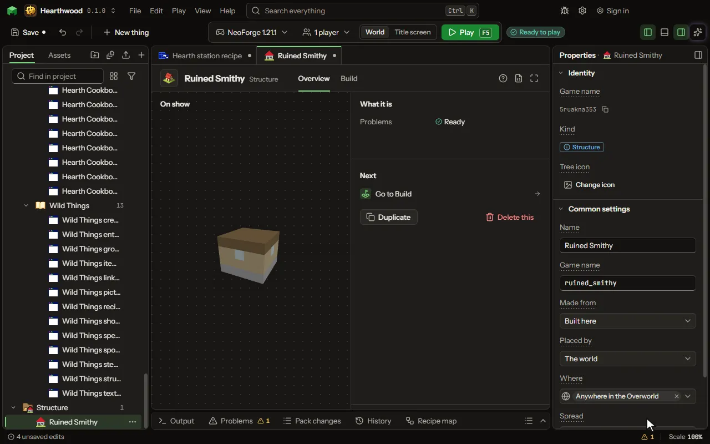

# Structure editor

A building or ruin placed in the world.

## How to add it

- New thing > The world > Structure

## What you can set

| Setting | What it does |
| --- | --- |
| Name | What you call it here. The game never shows it. |
| Game name | The structure's name in the game, as a command finds it: /locate structure. |
| Made from | Built here, block by block, or a structure file saved in the game with a structure block. Choose one of: Built here, A structure file. |
| Blocks | Built on the Build tab, layer by layer. |
| File | A structure saved in the game with a structure block, from its generated folder. |
| Placed by | Whether the world's generation places it on its own, or it is only a piece another structure joins where its jigsaw blocks are. Choose one of: The world, Joining only, A rule, while playing. |
| Where | The biomes it stands in. Pick them by name, or choose the whole Overworld. |
| Spread | Where the world puts it: at random places kept apart, a set number in rings around the world's centre as strongholds are, or just one at the centre, in the nearest of its biomes. Choose one of: At random, kept apart, In rings around the centre, One, at the world's centre. |
| Apart | About how far apart two of them stand, in chunks of sixteen blocks. From 2 to 256 chunks. |
| Never closer than | The least distance between two of them, in chunks. From 1 to 255 chunks. |
| First ring at | How far from the world's centre its first ring is: strongholds' is 32 chunks. From 1 to 1023 chunks. |
| How many | How many of it the world has in all, set in rings around its centre. From 1 to 128. |
| Joins to | The pieces that join it where it has a jigsaw block, each as likely as its weight. A jigsaw block on an edge of a build faces out from that edge, and a piece joins it by one of its own facing back. Each row has: Piece, Weight. |
| Joins deep | How many pieces deep it grows from the first: each piece's own jigsaw blocks join the pieces it lists in turn. From 1 to 20 joins. |
| Ends with | A piece that closes a join when the structure runs out of depth or room: a wall or a dead end, so no doorway opens into the rock. |
| Fewest rooms | The least rooms a dungeon built by a rule has, the first and the last counted. It may have fewer only when no more fit at its doors. From 1 to 200 rooms. |
| Most rooms | The most rooms a dungeon built by a rule has. Each build picks a count between fewest and most from its seed. From 1 to 200 rooms. |
| Last room | The room built last, at the door farthest from the first room: where a boss or a treasure waits. Empty: the dungeon has no last room of its own. |
| Waiting in the last room | A mob that appears in the middle of the last room when the dungeon is built, and stays there. Empty: none. |
| Chest in the last room | A chest in the middle of the last room, filled from this loot table when it is first opened. Empty: no chest. |
| Used at most | How many times this room may stand in one dungeon built by a rule. 0 means as often as the dice give it. Once it has stood that many times, no more are placed. From 0 to 200 times. |
| Used at least | How many times this room must stand in one dungeon built by a rule. 0 means not asked. If the dice left it short, it is added at doors still open, even past the most rooms. From 0 to 200 times. |
| Close open doors with | The block that fills a door no room was joined to, so no doorway opens into the rock or the empty. |
| Door height | How tall a door left open is closed: the block of the door and the blocks above it. From 1 to 8 blocks. |
| Other first rooms | Other pieces it may start from, each as likely as its weight beside its own, which weighs 1. Each row has: Piece, Weight. |
| Spreads up to | How far its pieces may reach from where it starts, in blocks; the game allows 128. From 1 to 128 blocks. |
| Stands | How it meets the ground. Choose one of: On the ground, the ground raised to meet it, In a pit dug for it, Buried, the ground over it, Underground, at a height of its own. |
| Sunk by | How many blocks below the ground its lowest layer is. From -64 to 64 blocks. |
| At height | The height its lowest layer stands at, deep in the stone: 0 is far below the sea, the deep dark lower still. From -60 to 300 blocks. |
| Spawners bring | The mob each spawner in its build brings out, as a dungeon's does. A build without a spawner brings none. |
| Chests hold | What its chests and barrels are filled with the first time they open. Left empty, they hold what was put in them. |
| Containers hold | What each kind of container in its build holds: items of your choosing in counts fixed or random, or a loot table of the mod's own or the game's; several rows of one container all go in it. A row's container can also stand at random spots: it is there as often as its share. Each row has: Container, Holds, Item, Fewest, Most, Loot table, There. |

## What it becomes in the game

It is not part of the game itself: it describes another mod or a file, so it has no side to choose.

## What it works with

It points at: [Biome](editor-biome.md), [Mob](editor-creature.md), [Loot table](editor-lootTable.md), [Block](editor-block.md).

## Picture

## Related pages

- [Structure](thing-structure.md)
- [Glossary](glossary.md)
