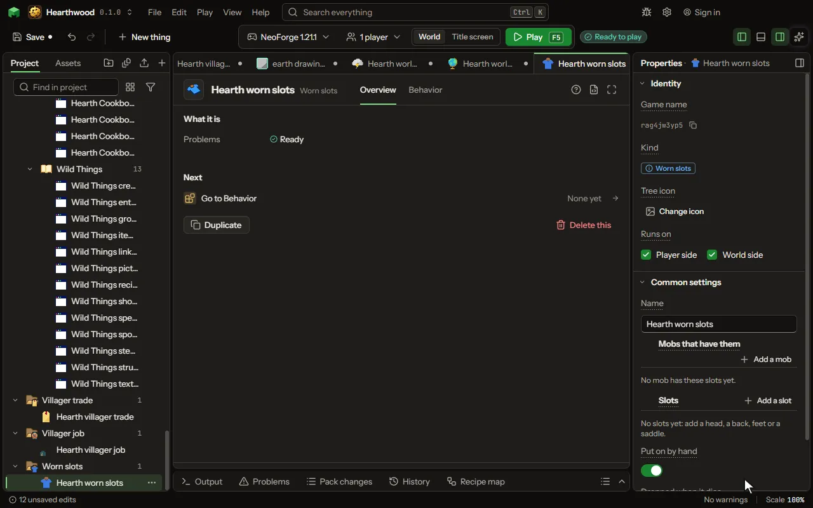

# Worn slots editor

Slots you name on any mob, the game's own or yours: a hat on a cow, boots on its four legs, a saddle on a pig, armor on a wolf. What is worn is drawn on the mob and works on it.

## How to add it

- New thing > Mobs and models > Worn slots

## What you can set

| Setting | What it does |
| --- | --- |
| Name | What you call this set of slots. |
| Mobs that have them | The game's mobs and your own creatures that get these slots. Each row has: Mob. |
| Slots | Each slot by its name, where the game keeps what is in it, the part of the mob it is drawn on, and what it takes. Each row has: Slot, Kept in, Drawn on, Takes. |
| Put on by hand | A player puts a piece on by using it on the mob, and takes the last one off crouching with an empty hand. |
| Dropped when it dies | What it wears falls to the ground when the mob dies. |

## What it becomes in the game

It runs on the player's side of the game.

## What it works with

It points at: [Mob](editor-creature.md).

## Picture

## Related pages

- [Worn slots](thing-wornSlots.md)
- [Glossary](glossary.md)
