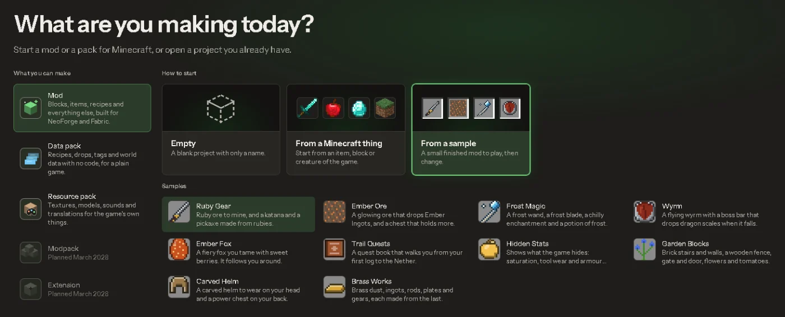

# Your first mod in 10 minutes

Keep this page open beside Modryos.

## 1. Start a mod

On the start screen, **What are you making today?**, start a new mod. Pick a template or a sample so there is already something in it. Give it a name and keep both loaders ticked.

## 2. Follow First steps

Modryos shows a small **First steps** card with four steps: **Look**, **Change**, **Play** and **In the game**. You can open it again any time with **Help > Getting started**.

- **Look.** Click one of your things in the Project list on the left. Blocks, items and creatures open so you can see how they are made.
- **Change.** Change its name or any number you see. You can always undo it, so try anything.
- **Play.** Press **Play** at the top. Modryos builds your mod and opens Minecraft with it. The first time takes a few minutes. Keep the window open.
- **In the game.** Find your thing in the creative inventory, in your mod's own tab. The card says "Your mod is in the game. Well done!" when it sees it.

## 3. Change it again

Change a colour or a name, then press **Reload in the game**. The change shows up without restarting. Press **Stop** when you are done.

## 4. Make the mod file

Use **File > Export > Make the mod file (.jar)**. See [Export](export.md).

Next: read more about [Play](play.md).
