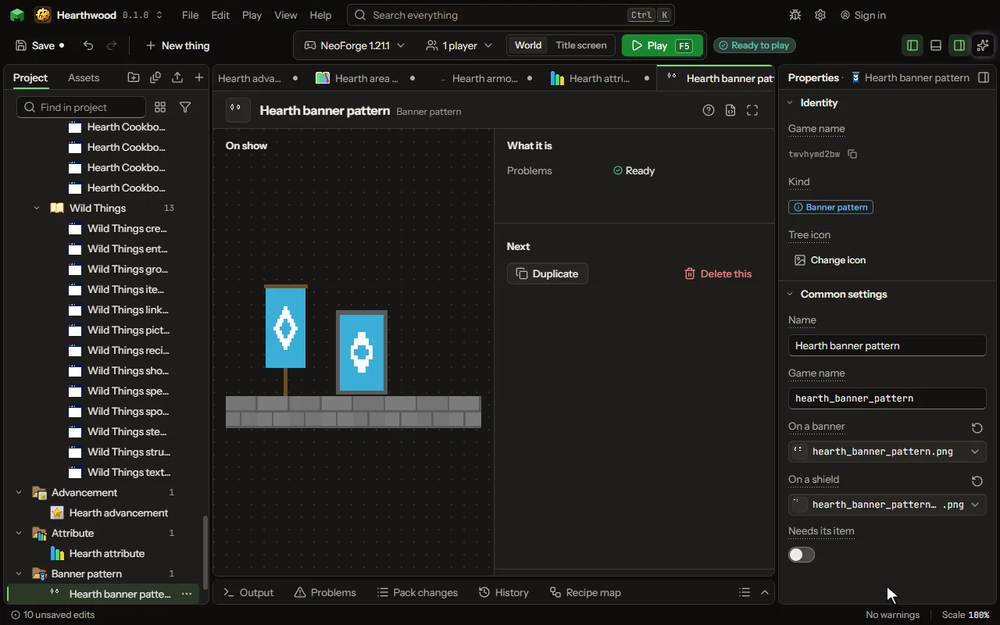

# Banner pattern

A pattern woven on a banner in the loom, and shown on a shield.

## How to add it

- New thing > Blocks and items > Banner pattern

## What you can set

The main settings are below. The [Banner pattern](editor-bannerPattern.md) editor lists every setting.

| Setting | What it does |
| --- | --- |
| Name | The pattern's name, as the loom and a banner's tooltip show it after the colour. |
| Game name | The pattern's name in the game, as a command or a data pack names it. |
| On a banner | The pattern on the banner's cloth, white where it shows: the loom dyes it. |
| On a shield | The pattern on a shield's face, white where it shows. |
| Needs its item | Whether the loom offers it only with its pattern item, as the globe. Off, it is always offered. |
| Item picture | The pattern item's picture, held and in the loom's slot. |

## What it becomes in the game

It is not part of the game itself: it describes another mod or a file, so it has no side to choose.

## What it works with

It does not point at other things.

## Picture

## Related pages

- [Banner pattern](editor-bannerPattern.md)
- [Templates and samples](templates-and-samples.md)
- [Glossary](glossary.md)
