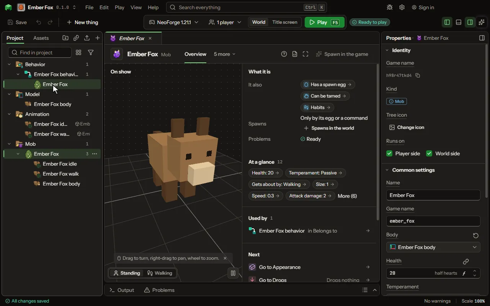

# Boss

A hostile mob with a boss bar, special moves and a phase it enters when it is badly hurt.

## How to add it

- New thing > Mobs and models > Boss

## What you can set

### Has a spawn egg

| Setting | What it does |
| --- | --- |
| Egg colour | The colour of the egg itself. |
| Spot colour | The colour of the spots on the egg. |

### Mind

| Setting | What it does |
| --- | --- |
| Moves | Special attacks it winds up and makes at what it fights, each waiting its own time. Each row has: Move, When, Phase, Reach, Wind-up, Cooldown, Hits for, Throws, Summons, How many, Spell, Pays from, Lasts, Blinks, Block it puts, Sound, Picture. |
| Job | What it does when it fights nothing. Choose one of: None, Guards its place, Follows its owner, Gathers items. |
| Reach | How far from where it first stood it guards or gathers. From 2 to 64 blocks. |
| Behaviours | What it does, top to bottom: the top one that can run wins. Drag to change the order. Empty: it keeps its usual ones. Each row has: Behaviour, Speed, Distance, Which creature, Which item or block, Extra, What it shoots, Time between shots, Only when. |

### Boss

| Setting | What it does |
| --- | --- |
| Bar colour | The colour of its bar at full health. Choose one of: Pink, Blue, Red, Green, Yellow, Purple, White. |
| Bar style | A smooth bar, or one cut into notches. Choose one of: Smooth, 6 notches, 10 notches, 12 notches, 20 notches. |
| Darkens sky | The sky darkens for every player who sees its bar, as the Wither's does. |
| Boss music | The game's boss music plays while its bar shows. |
| Fog | Fog closes in while its bar shows, as the Ender Dragon's does. |
| Phases | As its health falls below each share it enters the phase: faster, harder hitting, a state played, a moment it cannot be hurt. Each row has: Name, Below, Speed, Hits, Armour added, Plays, Cannot be hurt for, Bar colour. |

Every mob also has the settings on the [Mob](editor-creature.md) page.

## What it becomes in the game

It is added to the game, so a player needs your mod to see it.

It comes with these abilities already on: Has a spawn egg, Mind, Boss.

## What it works with

It points at: [Model](editor-model.md), [Sound](editor-sound.md), [Damage type](editor-damageType.md), [Code](editor-code.md).

Other things that open the same editor: [Mob](thing-creature.md), [Pet](thing-pet.md), [Mount](thing-mount.md), [Flying mount](thing-flyingMount.md), [Sea mount](thing-seaMount.md).

## Picture

## Related pages

- [Mob](editor-creature.md)
- [Templates and samples](templates-and-samples.md)
- [Glossary](glossary.md)
