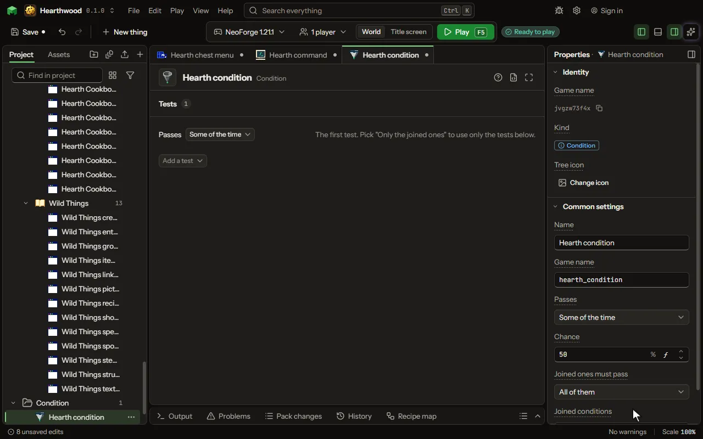

# Condition

A test in plain words, like half of the time, only in a biome, only at night. A loot row or an advancement can say Only when and name it.

## How to add it

- New thing > Crafting and loot > Condition

## What you can set

The main settings are below. The [Condition](editor-condition.md) editor lists every setting.

| Setting | What it does |
| --- | --- |
| Name | A name for you. |
| Game name | The condition's name in the game, as a data pack or another mod names it. |
| Passes | What the game checks. Pick none to only join other conditions. Choose one of: Some of the time, Only in a biome, Only with a tool, Only at night, Only when sneaking, Only the joined ones. |
| Chance | How often it passes, out of a hundred. 50 is half of the time. From 0 to 100 percent. |
| Biome | The biome it must be in. |
| Tool | The item held in the hand. Start with # for a group of items. |
| Joined ones must pass | All of them, any one of them, or none of them. It joins this condition's own test and the ones below. Choose one of: All of them, Any of them, None of them. |
| Joined conditions | Other conditions of yours to join with this one. Do not join a condition to itself. |

## What it becomes in the game

It is not part of the game itself: it describes another mod or a file, so it has no side to choose.

## What it works with

It does not point at other things.

## Picture

## Related pages

- [Condition](editor-condition.md)
- [Templates and samples](templates-and-samples.md)
- [Glossary](glossary.md)
