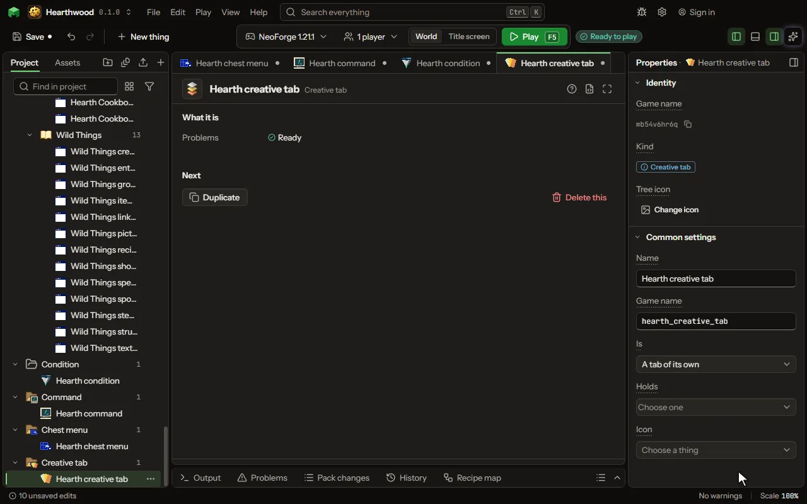

# Creative tab

A tab of the creative inventory with the things you put in it, or your things added to one of the game's tabs.

## How to add it

- New thing > Screens and guides > Creative tab

## What you can set

The main settings are below. The [Creative tab](editor-creativeTab.md) editor lists every setting.

| Setting | What it does |
| --- | --- |
| Name | What the tab is called in the creative inventory. |
| Game name | The tab's id inside the game, in small letters. The Name is what players read on the tab. |
| Is | A tab of its own beside the game's, or the things added to the end of one of the game's own tabs. Choose one of: A tab of its own, Added to Building Blocks, Added to Colored Blocks, Added to Natural Blocks, Added to Functional Blocks, Added to Redstone Blocks, Added to Tools & Utilities, Added to Combat, Added to Food & Drinks, Added to Ingredients, Added to Spawn Eggs. |
| Holds | The things in it, in this order: yours and the game's. Yours in a tab of its own leave the mod's main tab. |
| Icon | What the tab shows on itself; with none, the first thing it holds. |

## What it becomes in the game

It is not part of the game itself: it describes another mod or a file, so it has no side to choose.

## What it works with

It points at: [Item](editor-item.md), [Block](editor-block.md).

## Picture

## Related pages

- [Creative tab](editor-creativeTab.md)
- [Templates and samples](templates-and-samples.md)
- [Glossary](glossary.md)
