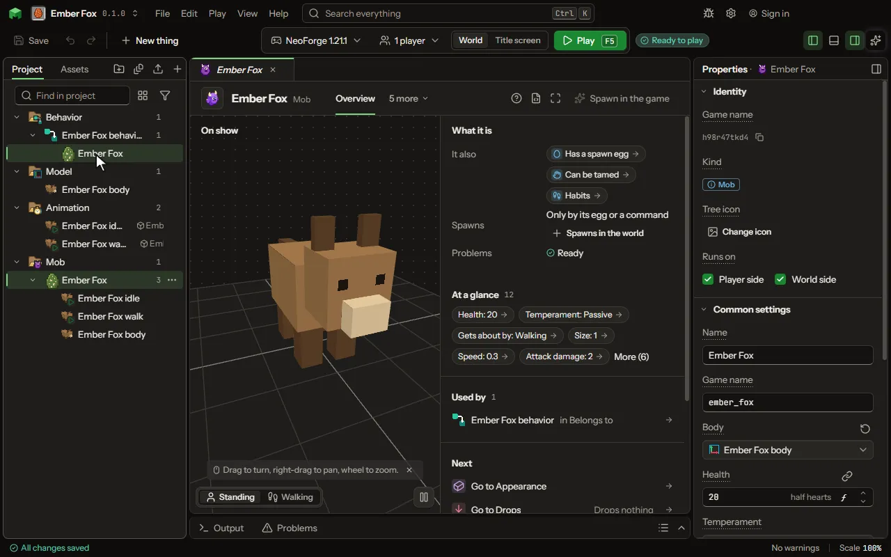

# Mob

A living thing with a model, animations and behavior.

## How to add it

- New thing > Mobs and models > Mob

## What you can set

### Has a spawn egg

| Setting | What it does |
| --- | --- |
| Egg colour | The colour of the egg itself. |
| Spot colour | The colour of the spots on the egg. |

Every mob also has the settings on the [Mob](editor-creature.md) page.

## What it becomes in the game

It is added to the game, so a player needs your mod to see it.

It comes with these abilities already on: Has a spawn egg.

## What it works with

It points at: [Model](editor-model.md), [Sound](editor-sound.md), [Damage type](editor-damageType.md), [Code](editor-code.md).

Other things that open the same editor: [Pet](thing-pet.md), [Mount](thing-mount.md), [Flying mount](thing-flyingMount.md), [Sea mount](thing-seaMount.md), [Boss](thing-boss.md).

## A recipe

[Make a creature](make-a-creature.md) shows a creature made in a few steps.

## Picture

## Related pages

- [Mob](editor-creature.md)
- [Templates and samples](templates-and-samples.md)
- [Glossary](glossary.md)
