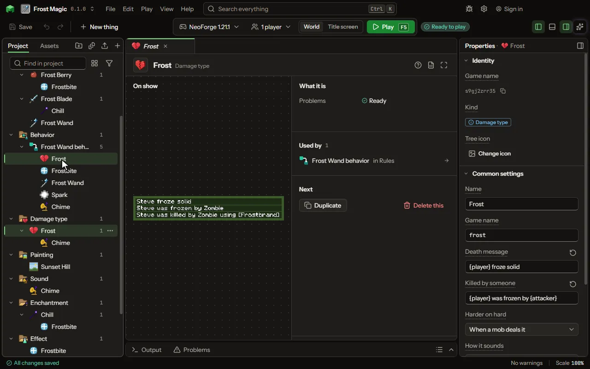

# Damage type

A way of getting hurt, with its own message.

## How to add it

- New thing > Logic and code > Damage type

## What you can set

The main settings are below. The [Damage type](editor-damageType.md) editor lists every setting.

| Setting | What it does |
| --- | --- |
| Name | A name for you. Players read the death messages, not this. |
| Game name | The damage type's name in the game, as a command, a data pack or another mod names it. |
| Death message | What the chat says when it kills a player on its own. (player) is the player's name. |
| Killed by someone | What the chat says when someone dealt it. (attacker) is who dealt it. |
| Harder on hard | Whether it hurts more on Hard and less on Easy, as a zombie's bite does. Choose one of: Never, When a mob deals it, Always. |
| How it sounds | The game's own hurt sound the victim makes: an ordinary hurt, thorns, drowning, burning, a sweet berry's poke or freezing. Choose one of: Hurt, Thorns, Drowning, Burning, Poking, Freezing. |

## What it becomes in the game

It is not part of the game itself: it describes another mod or a file, so it has no side to choose.

## What it works with

It points at: [Sound](editor-sound.md).

## Picture

## Related pages

- [Damage type](editor-damageType.md)
- [Templates and samples](templates-and-samples.md)
- [Glossary](glossary.md)
