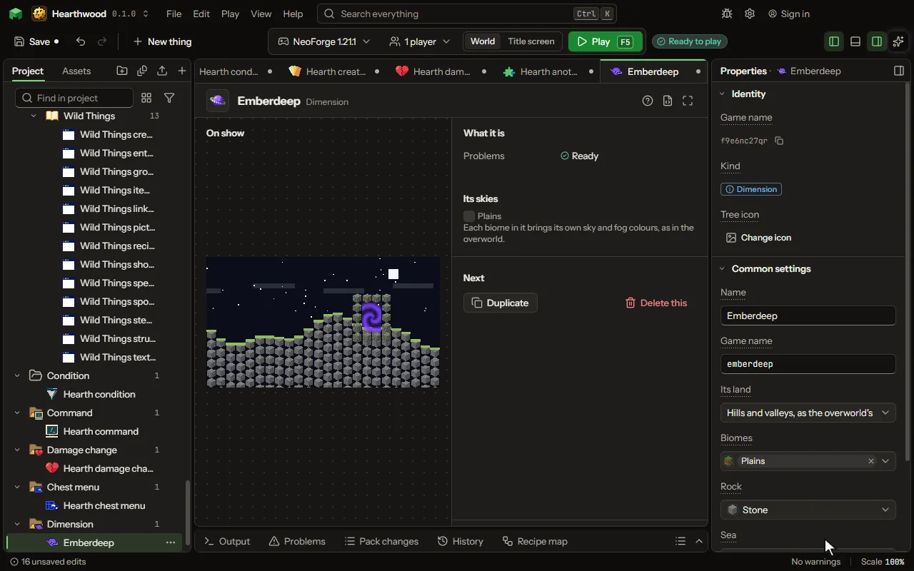

# Dimension

A whole other world reached through a portal.

## How to add it

- New thing > The world > Dimension

## What you can set

The main settings are below. The [Dimension](editor-dimension.md) editor lists every setting.

| Setting | What it does |
| --- | --- |
| Name | What you call it here. |
| Game name | The dimension's name in the game, as a command goes there: /execute in. |
| Its land | What its ground is like. Choose one of: Hills and valleys, as the overworld's, Shaped land, each biome its own, Islands floating in the sky, Caves under a ceiling of rock, Flat, in layers, Empty, nothing at all. |
| Biomes | The biomes it is made of, yours and the game's, each taking a share of its land. |
| Rock | The block its hills are made of, under each biome's own ground. |
| Sea | What fills its low places. Choose one of: Water, Lava, Nothing. |
| Land height | The height its land stands at; each biome stands above or below it by its own land height. From -32 to 256 blocks. |
| Hilliness | How hilly the whole dimension is; each biome's roughness is a share of it. From 0 to 100 percent. |
| Caves | The caves cut into its ground: none, winding tunnels, or tunnels and great caverns as the overworld's. Choose one of: None, Tunnels, Tunnels and caverns. |
| Layers | Its ground from the bottom up, each layer a block and how thick it is. Each row has: Block, Thick. |
| Time | Whether day turns to night there. Choose one of: Day and night, as the overworld, Always day, Always night. |
| Sky | What is over it. The colours of its sky and fog are its biomes'. Choose one of: A sky with the sun and the moon, No sky, a thick haze, A dark sky, as the end's. |
| Clouds | Whether clouds drift over it, under a sky with the sun and the moon. |
| Light in the dark | How bright its darkest places are: none is as the overworld at night. From 0 to 100 percent. |
| Portal | A way in, as the nether's: a frame of a block, lit by an item. Its inside becomes a portal; standing in it takes a player there and back. |
| Frame | The block its frame is built of, two to twenty one wide and three to twenty one high inside. |
| Lit by | The item a player uses on the frame to open it. |
| Portal colour | The colour of the swirl inside the frame. |

## What it becomes in the game

It is not part of the game itself: it describes another mod or a file, so it has no side to choose.

## What it works with

It points at: [Biome](editor-biome.md), [Block](editor-block.md).

## Picture

## Related pages

- [Dimension](editor-dimension.md)
- [Templates and samples](templates-and-samples.md)
- [Glossary](glossary.md)
