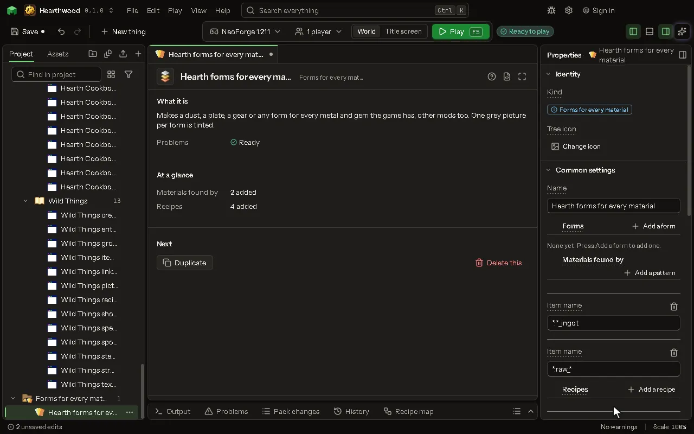

# Forms for every material

Makes a dust, a plate, a gear or any other form for every metal and gem the game has when it starts, other mods too. One grey picture per form is tinted in each material's colour.

## How to add it

- New thing > Blocks and items > Forms for every material

## What you can set

The main settings are below. The [Forms for every material](editor-formSet.md) editor lists every setting.

| Setting | What it does |
| --- | --- |
| Name | A name for this set, only for you. |
| Forms | Each row is one thing made for every material, like a dust or a plate. Each row has: Form, Item name in the game, Tag, Picture. |
| Materials found by | A material is found for every item that fits one of these. A star stands for any text. Each row has: Item name. |
| Recipes | Recipes made for every material found when the game starts. Write one once with (material) and form names like (ingot), (nugget) or (dust); a recipe is skipped for a material when an item it needs is missing. Each row has: Recipe type, Recipe (JSON), Only if this mod is loaded. |
| Only if not made yet | On: a form is not made when an item with the same name already exists, so you never get two copper dusts. Mods that load after yours are not seen. |

## What it becomes in the game

It is not part of the game itself: it describes another mod or a file, so it has no side to choose.

## What it works with

It does not point at other things.

## Picture

## Related pages

- [Forms for every material](editor-formSet.md)
- [Templates and samples](templates-and-samples.md)
- [Glossary](glossary.md)
