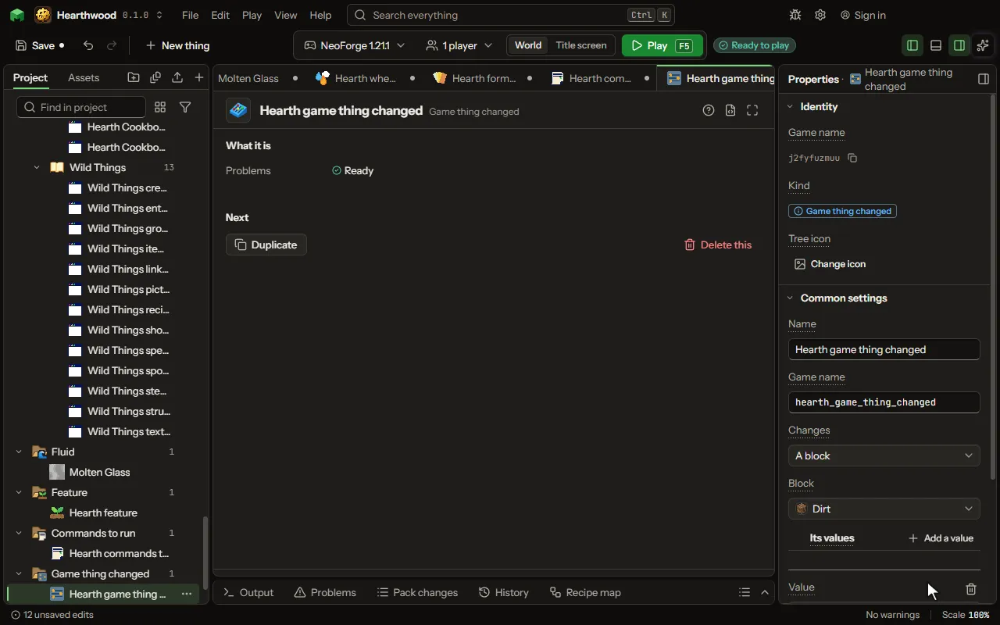

# Game thing changed

One of the game's own blocks, items or mobs given new values, such as a block's hardness, an item's stack size or a mob's health, a structure the game makes no more, or a limit the game sets, such as the anvil's most cost.

## How to add it

- New thing > Crafting and loot > Game thing changed

## What you can set

The main settings are below. The [Game thing changed](editor-gameChange.md) editor lists every setting.

| Setting | What it does |
| --- | --- |
| Name | What it is called here. |
| Game name | Its name inside the mod, in small letters. |
| Changes | What kind of the game's things this changes: a block, an item, a mob, structures, or limits the game sets. Choose one of: A block, An item, A mob, Structures, Limits. |
| Item | The item to change, the game's, another mod's or yours: how many stack, and how many uses it lasts. |
| Stacks to | How many fit in one stack, up to 99, such as ender pearls 64; 0 keeps the game's. Items that wear out stack to 1. From 0 to 99. |
| Uses | How many uses it lasts before it breaks; 0 keeps the game's. An item given uses stacks to 1. From 0 to 100000. |
| Food it gives | How much hunger it fills when eaten, up to 20. 0 leaves the game's; above 0 makes it food. From 0 to 20. |
| Its limits | Each limit of the game to change, and how: made a number, multiplied, or added to; in one dimension or every one; or taken from a setting the player changes. Each row has: Value, How, Number, Only in, Player's setting. |
| Block | The block to change, the game's, another mod's or yours. |
| Its values | Each value of the block to change, and how: made a number, multiplied, or added to. Each row has: Value, How, Number. |
| Mob | The mob to change, the game's, another mod's or yours. Mobs already in a world change as they load. |
| Its values | Each value of the mob to change, and how: made a number, multiplied, or added to. Each row has: Value, How, Number. |
| Never made | Structures the game no longer makes, such as mineshafts; one of yours can take their place. |

## What it becomes in the game

It is not part of the game itself: it describes another mod or a file, so it has no side to choose.

## What it works with

It points at: [Block](editor-block.md), [Mob](editor-creature.md).

## Picture

## Related pages

- [Game thing changed](editor-gameChange.md)
- [Templates and samples](templates-and-samples.md)
- [Glossary](glossary.md)
