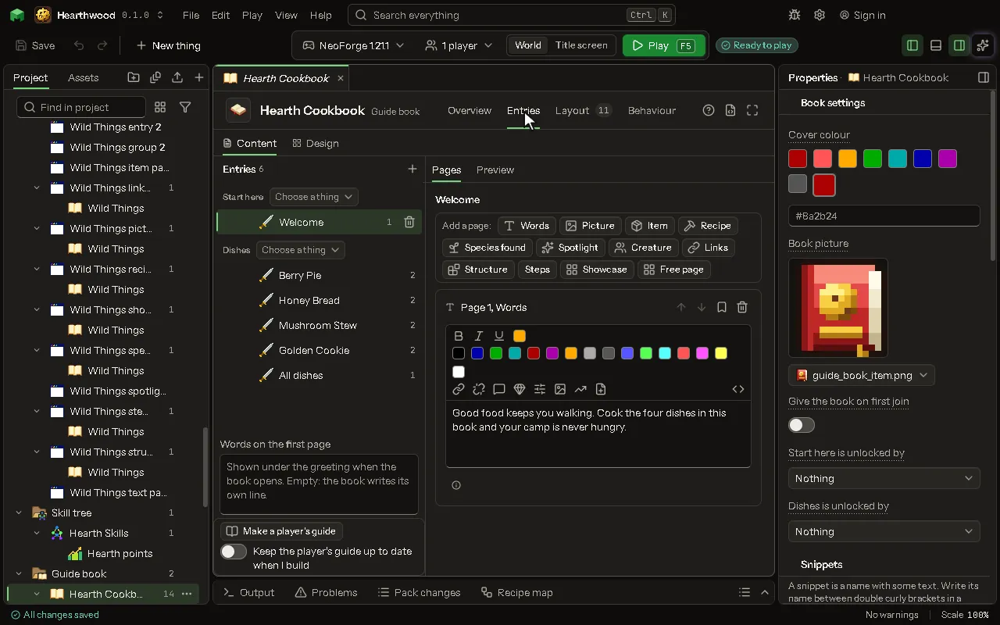

# Guide book

A book of pages about the mod: words, pictures, items and recipes.

## How to add it

- New thing > Screens and guides > Guide book

## What you can set

The main settings are below. The [Guide book](editor-guideBook.md) editor lists every setting.

| Setting | What it does |
| --- | --- |
| Name | What you call it here, and the book's title in the game. |
| Game name | The name the mod knows it by. Lowercase letters, numbers and underscores. |
| Entries | Its entries and their pages, written on the Entries tab. |
| Layout | Where everything on the screen is, laid out on the Layout tab. |

## What it becomes in the game

It is not part of the game itself: it describes another mod or a file, so it has no side to choose.

## What it works with

It does not point at other things.

## Picture

## Related pages

- [Guide book](editor-guideBook.md)
- [Templates and samples](templates-and-samples.md)
- [Glossary](glossary.md)
