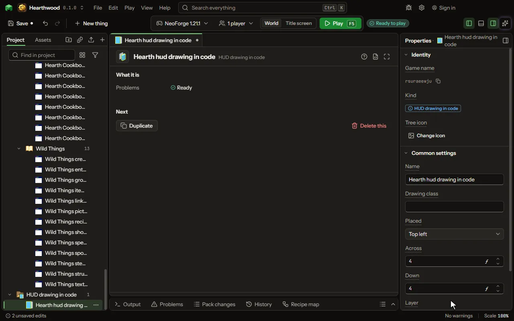

# HUD drawing in code

Your own code that draws on the HUD every frame, in a box you place on the screen.

## How to add it

- New thing > Screens and guides > HUD drawing in code

## What you can set

The main settings are below. The [HUD drawing in code](editor-hudDraw.md) editor lists every setting.

| Setting | What it does |
| --- | --- |
| Name | What you call it in the project. |
| Drawing class | Your class's full name. It implements the mod's HudDraws.Drawing: handed a canvas and its box, it draws with the canvas's fill, text and item, the same on every game version. |
| Placed | The edge or the middle of the screen its box keeps to. Choose one of: Top left, Top center, Top right, Left, Center, Right, Bottom left, Bottom center, Bottom right. |
| Across | How far its box is set in from that edge across, in the GUI's pixels; from the middle, how far to the right. From -4000 to 4000. |
| Down | How far its box is set in from that edge up or down, in the GUI's pixels; from the middle, how far down. From -4000 to 4000. |
| Layer | Over the game's HUD, above the hotbar, the chat and the rest; or under it, over the world. Choose one of: Over the HUD, Under the HUD. |

## What it becomes in the game

It is not part of the game itself: it describes another mod or a file, so it has no side to choose.

## What it works with

It does not point at other things.

## Picture

## Related pages

- [HUD drawing in code](editor-hudDraw.md)
- [Templates and samples](templates-and-samples.md)
- [Glossary](glossary.md)
