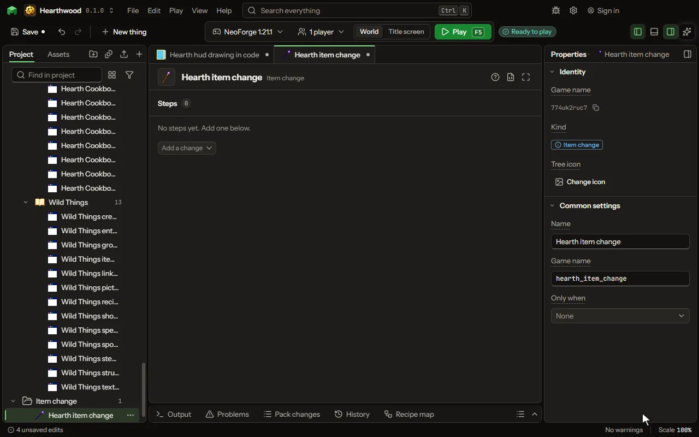

# Item change

What happens to an item after it is made: its count, its wear, a name, a lore line, a random enchantment. A loot row can say Then change it and name one.

## How to add it

- New thing > Crafting and loot > Item change

## What you can set

The main settings are below. The [Item change](editor-itemChange.md) editor lists every setting.

| Setting | What it does |
| --- | --- |
| Name | A name for you. |
| Game name | The change's name in the game, as a data pack or another mod names it. |
| Only when | A condition that must pass for the steps to apply. Make one with New, Condition. |

## What it becomes in the game

It is not part of the game itself: it describes another mod or a file, so it has no side to choose.

## What it works with

It points at: [Condition](editor-condition.md).

## Picture

## Related pages

- [Item change](editor-itemChange.md)
- [Templates and samples](templates-and-samples.md)
- [Glossary](glossary.md)
