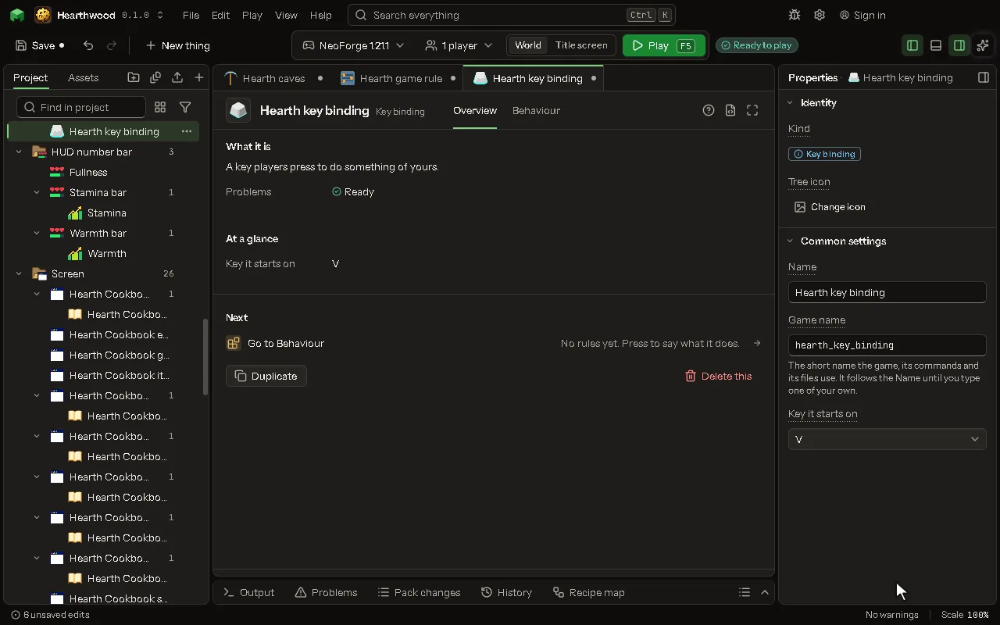

# Key binding

A key players press to do something of yours.

## How to add it

- New thing > Screens and guides > Key binding

## What you can set

The main settings are below. The [Key binding](editor-keyBinding.md) editor lists every setting.

| Setting | What it does |
| --- | --- |
| Name | What the Controls screen calls it. |
| Game name | The name rules and your own code know it by. |
| Starts on | The key it starts on; a player may change it in the game's Controls screen. Choose one of: V, B, G, H, J, K, N, M, R, Z, U, Y, O, P, ` (backtick, left of 1), Left Alt, Caps Lock. |

## What it becomes in the game

It is not part of the game itself: it describes another mod or a file, so it has no side to choose.

## What it works with

It does not point at other things.

## Picture

## Related pages

- [Key binding](editor-keyBinding.md)
- [Templates and samples](templates-and-samples.md)
- [Glossary](glossary.md)
