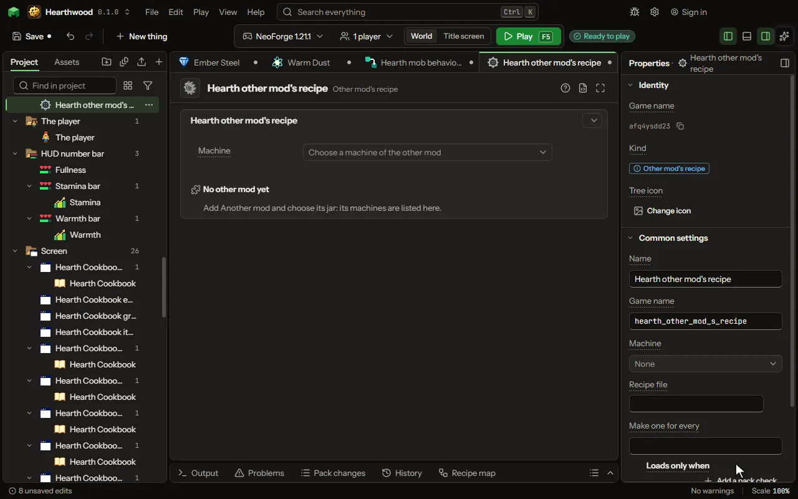

# Other mod's recipe

A recipe for a machine from a mod yours builds on, filled in by clicks.

## How to add it

- New thing > Crafting and loot > Other mod's recipe

## What you can set

The main settings are below. The [Other mod's recipe](editor-modRecipe.md) editor lists every setting.

| Setting | What it does |
| --- | --- |
| Name | A name for you. Players never see it. |
| Game name | The file name inside the mod. Lowercase letters, digits and underscores. |
| Machine | The other mod's kind of recipe, read from its jar: each machine reads its own kind. |

## What it becomes in the game

It is not part of the game itself: it describes another mod or a file, so it has no side to choose.

## What it works with

It does not point at other things.

## Picture

## Related pages

- [Other mod's recipe](editor-modRecipe.md)
- [Templates and samples](templates-and-samples.md)
- [Glossary](glossary.md)
