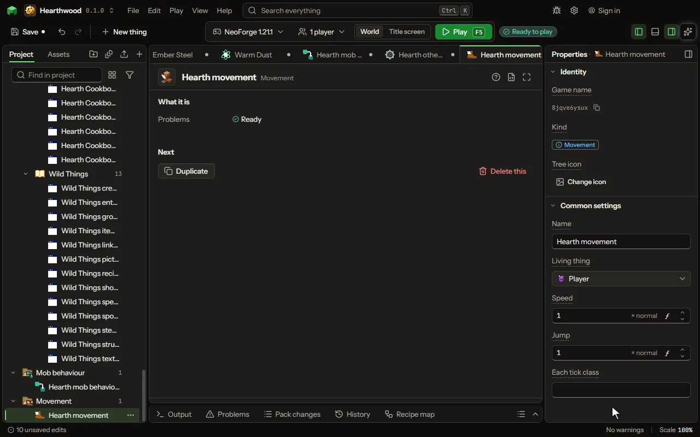

# Movement

How a living thing moves, the player or a mob: its speed and its jump, and a class of yours run as it moves.

## How to add it

- New thing > Mobs and models > Movement

## What you can set

The main settings are below. The [Movement](editor-movement.md) editor lists every setting.

| Setting | What it does |
| --- | --- |
| Name | What you call it in the project. |
| Living thing | Choose a mob, or a group of them such as the undead. |
| Speed | How fast it walks, as a share of its own; 1 is its own. From 0 to 20 normal. |
| Jump | How strongly it jumps, as a share of its own; 1 is its own. From 0 to 20 normal. |
| Each tick class | Your class's full name, or empty. It implements the mod's Movements.EachTick and runs every tick for each of them, a mob's on the server and the player's on its own client, where it may change its motion. |

## What it becomes in the game

It is not part of the game itself: it describes another mod or a file, so it has no side to choose.

## What it works with

It does not point at other things.

## Picture

## Related pages

- [Movement](editor-movement.md)
- [Templates and samples](templates-and-samples.md)
- [Glossary](glossary.md)
