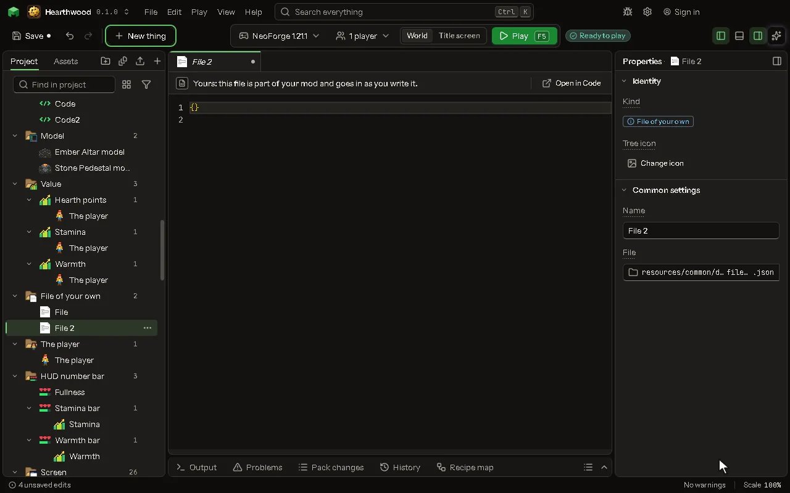

# File of your own

Any file the mod ships as it is, under resources/: data, assets, anything the game reads.

## How to add it

- New thing > Logic and code > File of your own

## What you can set

The main settings are below. The [File of your own](editor-ownFile.md) editor lists every setting.

| Setting | What it does |
| --- | --- |
| Name | What you call it here. |
| File | Where it is: resources/common reaches every target, resources/neoforge and resources/fabric one each. |

## What it becomes in the game

It is not part of the game itself: it describes another mod or a file, so it has no side to choose.

## What it works with

It does not point at other things.

Other things that open the same editor: [Pack file](thing-packFile.md), [Dimension file of your own](thing-dimensionFile.md), [Look of a block made in code](thing-blockLook.md), [Mixin config](thing-mixinConfig.md), [Mixin](thing-mixin.md), [Access widener (Fabric)](thing-accessWidener.md), [Access transformer (NeoForge)](thing-accessTransformer.md).

## Picture

## Related pages

- [File of your own](editor-ownFile.md)
- [Templates and samples](templates-and-samples.md)
- [Glossary](glossary.md)
