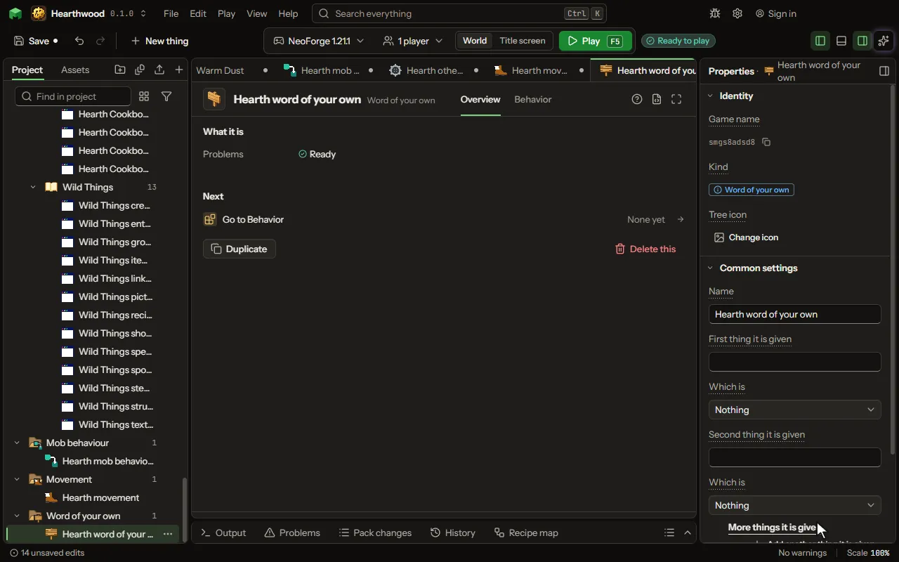

# Word of your own

A few lines you name once and use in any rule as one line: it is given as many things as it needs, and it can give back an answer.

## How to add it

- New thing > Logic and code > Word of your own

## What you can set

The main settings are below. The [Word of your own](editor-ownWord.md) editor lists every setting.

| Setting | What it does |
| --- | --- |
| Name | What the word is called where a rule uses it, such as Greet or Bonus for. |
| First thing it is given | A name for something the rule that uses this word hands it, such as who or how much. Leave its kind at Nothing to hand it nothing. |
| Which is | What kind of thing it is given here. Choose one of: Nothing, A number, Words, Yes or no, A player, A mob, A place, An item. |
| Second thing it is given | A name for something the rule that uses this word hands it, such as who or how much. Leave its kind at Nothing to hand it nothing. |
| Which is | What kind of thing it is given here. Choose one of: Nothing, A number, Words, Yes or no, A player, A mob, A place, An item. |
| More things it is given | As many more things as the word needs, each with a name and what it is. The rule that uses the word fills each one. Each row has: Called, Which is. |
| It gives back | What the rule that uses this word gets back from it: nothing, or a number, words, or yes or no, set by a Give back line. Choose one of: Nothing, A number, Words, Yes or no. |

## What it becomes in the game

It is not part of the game itself: it describes another mod or a file, so it has no side to choose.

## What it works with

It does not point at other things.

## Picture

## Related pages

- [Word of your own](editor-ownWord.md)
- [Templates and samples](templates-and-samples.md)
- [Glossary](glossary.md)
