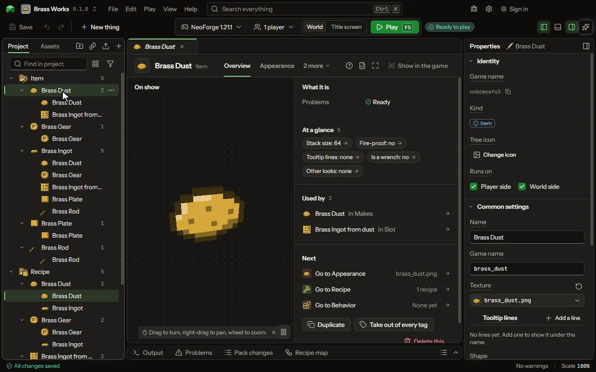

# Golem-style creature

A creature built of parts and materials, as a golem is: used on a block it becomes the creature, its health, speed, armor, jobs and look its parts'.

## How to add it

- New thing > Mobs and models > Golem-style creature

## What you can set

### Made of parts

| Setting | What it does |
| --- | --- |
| First part | A part it is made of, drawn first, under the others. |
| Second part | A part it is made of, drawn over the first. |
| Third part | A part it is made of, drawn over the second. |
| Fourth part | A part it is made of, drawn over the rest; leave it empty for a tool of three. |
| Its own changes | Changes to the stats after its parts', such as a hammer that mines three across at half speed. Each row has: Stat, How, Amount, Only on blocks. |
| Becomes a creature | Used on a block, it is placed as this creature, built of its parts: their materials give its health, speed, armor and damage, their jobs its work, their pieces its look. Its owner crouching with an empty hand takes it apart into this item again; when it dies it drops its parts. |

Every item also has the settings on the [Item](editor-item.md) page.

## What it becomes in the game

It is added to the game, so a player needs your mod to see it.

It comes with these abilities already on: Made of parts.

## What it works with

It points at: [Model](editor-model.md).

Other things that open the same editor: [Item](thing-item.md), [Crate](thing-lootCrate.md), [Backpack](thing-backpack.md), [Settings copier](thing-settingsCopier.md), [Letter](thing-letter.md), [Pocket](thing-pocket.md), [Storage disk](thing-storageDisk.md), [Disk for fluids](thing-fluidDisk.md), [Wireless terminal](thing-wirelessTerminal.md), [Upgrade](thing-upgrade.md), [Structure finder](thing-structureFinder.md), [Pointer](thing-pointer.md), [Designator](thing-designator.md), [Item filter](thing-itemFilter.md), [Configurator](thing-configurator.md), [Face part](thing-facePart.md), [Waypoint compass](thing-waypointCompass.md), [Spell wand](thing-spellWand.md), [Spell book](thing-spellBook.md), [Spell scroll](thing-spellScroll.md), [Tool](thing-tool.md), [Weapon](thing-weapon.md), [Armor](thing-armour.md), [Food](thing-food.md), [Fuel](thing-fuel.md), [Bow](thing-bow.md), [Crossbow](thing-crossbow.md), [Shield](thing-shield.md), [Part](thing-part.md), [Tool of parts](thing-partsTool.md), [Battery](thing-battery.md), [Powered tool](thing-poweredTool.md), [Powered armour](thing-poweredArmour.md), [Building wand](thing-buildingWand.md), [Copy wand](thing-copyWand.md), [Capsule](thing-capsule.md), [Building plan](thing-buildingPlan.md), [Mob catcher](thing-mobCatcher.md), [Carving tool](thing-carvingTool.md), [Bag of pieces](thing-bitBag.md), [Shape pattern](thing-shapePattern.md), [Tree axe](thing-treeAxe.md), [Vein pickaxe](thing-veinPickaxe.md), [Module](thing-module.md), [Building tool](thing-builder.md), [Thrown weapon](thing-thrown.md), [Music disc](thing-musicDisc.md), [Shears](thing-shears.md), [Fishing rod](thing-fishingRod.md), [Tool for everything](thing-multiTool.md), [Hat](thing-hat.md), [Vehicle part](thing-vehiclePart.md).

## Picture

## Related pages

- [Item](editor-item.md)
- [Templates and samples](templates-and-samples.md)
- [Glossary](glossary.md)
