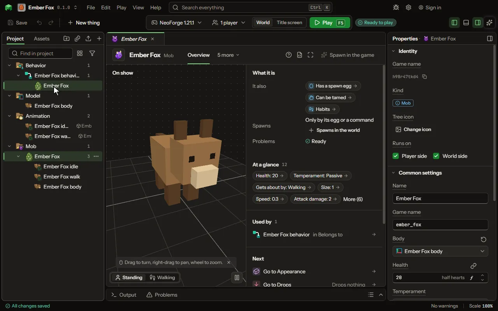

# Pet

A mob a player tames with an item; it sits, follows and fights for them.

## How to add it

- New thing > Mobs and models > Pet

## What you can set

### Has a spawn egg

| Setting | What it does |
| --- | --- |
| Egg colour | The colour of the egg itself. |
| Spot colour | The colour of the spots on the egg. |

### Can be tamed

| Setting | What it does |
| --- | --- |
| Tamed by | What makes it a player's: an item given to it, riding it until it calms, or only a rule's words. Choose one of: Giving it an item, Riding it until it calms, Only a rule. |
| Tamed with | The item a player gives it, one each try. |
| Chance a try | How likely each item given, or each time it is ridden, tames it. From 1 to 100 percent. |
| Sits when told | Its owner's use makes it sit and stay, and stand again. |
| Follows owner | It keeps near its owner when it is not sitting. |
| Follows from | How far its owner may go before it comes after them. From 2 to 32 blocks. |
| Catches up | Left far behind, it appears beside its owner, as a tame wolf does. |
| Strikes back at its owner | Off, a tamed one never targets or attacks its owner or the owner's team, however it was hurt, as a wolf does not. |
| Defends owner | It attacks what hurts its owner and what its owner attacks. |
| Healed with | Foods its owner gives it to heal it. |

### Habits

| Setting | What it does |
| --- | --- |
| Looks at | What its head turns to follow. Choose one of: What it fights, Players near, Its owner, Nothing. |
| Follows a player holding | It walks up to a player holding one of these, as a cow follows wheat. |
| Fights | When it goes after what its temperament makes it fight. Choose one of: Always, Only at night, Only by day, Only when hit. |
| Sleeps | It lies still, waking when hurt; a state named Sleeping plays while it sleeps. Choose one of: Never, At night, By day. |
| Keeps with | Whether it wanders alone, keeps near others of its kind, follows one of them as their leader, or moves as one with them in a swarm, each its spacing apart. Choose one of: Nobody, Its herd, A leader, A swarm. |
| Spacing | How far apart the swarm keeps, in blocks. Each one keeps its own place round the eldest, so the group moves as one. From 0.25 to 16 blocks. |
| Avoids | What it keeps away from, and how fast it runs from it. Each row has: What, Keeps away, Runs at. |
| Grazes on | Blocks it eats where it stands, as a sheep eats grass, healing. |
| Eats from the ground | Items lying near that it goes to and eats, healing. |
| Flees under | Hurt below this share of its health, it runs from what hurt it; none never. From 0 to 100 percent. |
| Head turns | How far its head turns from its body, either way. From 10 to 180 degrees. |
| Babies follow | A baby keeps near a grown one of its kind. |
| Heals by | How much eating heals it. From 0 to 100 halfHearts. |

Every mob also has the settings on the [Mob](editor-creature.md) page.

## What it becomes in the game

It is added to the game, so a player needs your mod to see it.

It comes with these abilities already on: Has a spawn egg, Can be tamed, Habits.

## What it works with

It points at: [Model](editor-model.md), [Sound](editor-sound.md), [Damage type](editor-damageType.md), [Code](editor-code.md).

Other things that open the same editor: [Mob](thing-creature.md), [Mount](thing-mount.md), [Flying mount](thing-flyingMount.md), [Sea mount](thing-seaMount.md), [Boss](thing-boss.md).

## Picture

## Related pages

- [Mob](editor-creature.md)
- [Templates and samples](templates-and-samples.md)
- [Glossary](glossary.md)
