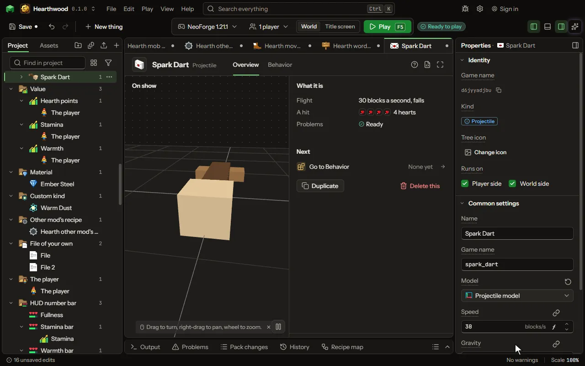

# Projectile

A thing that flies, drawn by a model: a spell, a dart, a boomerang, a homing missile. Shot by the shoot words and a creature's Throw move.

## How to add it

- New thing > Mobs and models > Projectile

## What you can set

The main settings are below. The [Projectile](editor-projectile.md) editor lists every setting.

| Setting | What it does |
| --- | --- |
| Name | What players see it called. |
| Game name | Its id in the game, small letters and underscores; the shoot words fire it by this. |
| Model | The model it is drawn by, made in the model editor. Its front faces where it flies. |
| Speed | How fast it leaves, in blocks a second; a snowball flies 30, an arrow from a full bow 60. It flies at this speed whatever fires it; 0 is set down where it is made, as a lit charge. From 0 to 200 blocksPerSecond. |
| Gravity | How fast it falls: 1 falls as a snowball does, 0 flies straight as a fireball, below 0 floats up as a balloon. From -10 to 10 normal. |
| Damage | How much it hurts a mob it hits, in hearts. From 0 to 1000 hearts. |
| Flight animation | An animation of its model it plays over and over as it flies: wings beating, a blade turning. |
| Scale | How big its model is drawn; 1 is the model's own size. From 0.0625 to 16. |
| Spin | Turns a second about the way it flies, as a shuriken or a drill spins; 0 flies straight. From 0 to 20 perSecond. |
| Drag | How much of its speed the air takes each second; a snowball loses 18. From 0 to 99 percent. |
| Lifetime | How long it flies before it ends where it is, or turns back when it returns. From 0.5 to 120 seconds. |
| Knockback | How hard it pushes a mob it hits; 1 is a sword's own push. From 0 to 10. |
| Sets alight | How long a mob it hits burns; 0 sets nothing alight. From 0 to 60 seconds. |
| Pierces | How many mobs it flies through before it stops at one. From 0 to 64 times. |
| Bounces | How many times it bounces off a wall before it ends there. From 0 to 64 times. |
| When it ends | What it does where it stops: vanish, stick in the block it hit as a thrown knife does, explode, break the block, or set fire. Choose one of: Vanishes, Sticks where it lands, Explodes, Breaks the block, Sets fire. |
| Explosion | How big the explosion is; TNT is 4. From 0.5 to 10. |
| Returns | Flies back to whoever threw it after it hits or reaches its reach, as a boomerang or a yoyo, through anything on the way. |
| Reach | How far it flies out before it turns back. From 1 to 128 blocks. |
| Homing | How hard it turns toward its target each tick: what its thrower fights, or the nearest mob. 0 flies where it was aimed. From 0 to 100 percent. |
| Homing reach | How far it looks for a target. From 1 to 64 blocks. |
| Trail | The particles it leaves behind it as it flies. Choose one of: None, Flame, Smoke, Heart, Crit, Portal, Happy, Soul, Snow, Enchanting letters, Music notes, Angry clouds, White clouds, Bubbles, A witch's sparkle, A totem's burst, A sword's sweep, End rod sparks, Glow squid light, Wax flecks, Electric sparks, Sculk souls, Water drops. |

## What it becomes in the game

It is added to the game, so a player needs your mod to see it.

## What it works with

It points at: [Model](editor-model.md), [Animation](editor-animation.md).

## Picture

## Related pages

- [Projectile](editor-projectile.md)
- [Templates and samples](templates-and-samples.md)
- [Glossary](glossary.md)
